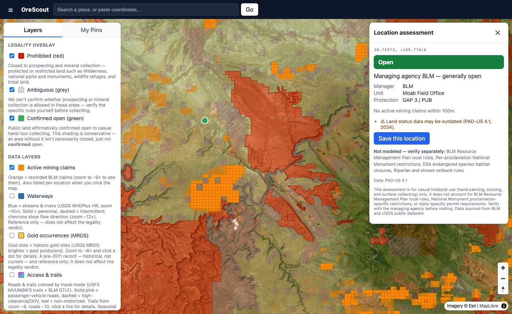
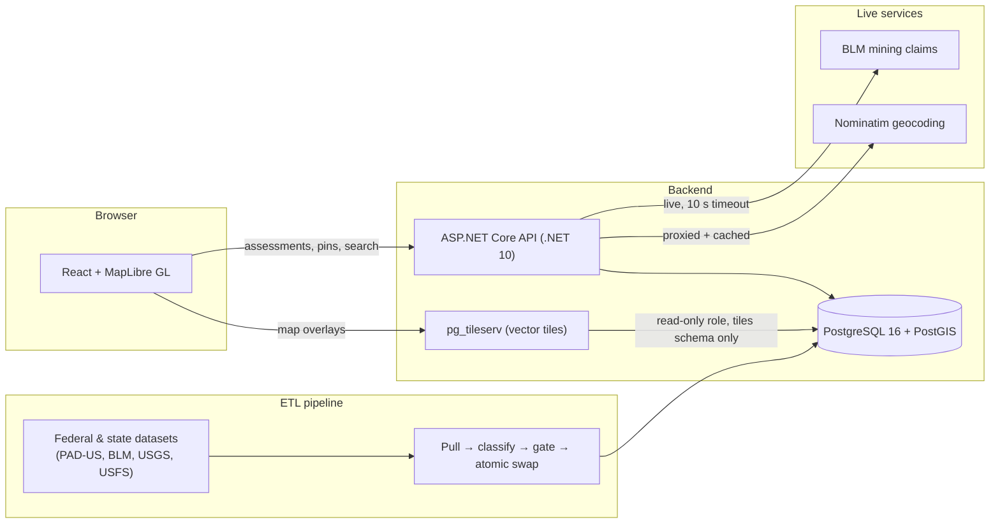

# OreScout

[](https://github.com/maxrubenmiller/orescout/actions/workflows/ci.yml)
[](LICENSE)

**Can I legally pan for gold or collect rocks *here*?** OreScout answers that question for any point in eight
western US states. It combines federal land-management data, live BLM mining-claim records, and a rules
engine that turns them into a plain-language verdict on a map.



## What it does

- **Click anywhere on the map** and get a verdict: **Open**, **Prohibited**, or a cautionary
  **Ambiguous**, with the land manager, unit, protection level, nearby mining claims, and the
  rules it *can't* model, so the user knows what to verify.
- **Color-coded overlays** show the same verdicts across NV, CA, AZ, CO, UT, NM, OR and ID, plus
  layers for active mining claims, waterways, historic gold occurrences, access roads/trails, and a
  modelled "prospecting potential" score.
- **Saved pins** keep a snapshot of the verdict when saved, warn if the land status has changed
  since, and export to GPX/KML for a GPS unit.

## The core idea: "open" must be earned

A false "you can collect here" is the expensive mistake, so the engine is built to avoid it:

- A location is shown as **open only when it is positively confirmed** as open public land. Private,
  state, tribal, unknown or missing data all fall back to a cautious verdict. Missing data can't
  produce a false "open"; only *wrong* data can, and that is measured.
- **Most restrictive wins** wherever designations overlap (e.g. a wilderness inside a national forest).
- **The map and the click can't disagree.** Rules run once at build time and the verdict is baked
  into one table that both the map tiles and the API read.
- **Live claims check.** Every assessment queries BLM's mining-claim records within 100 m. A claim
  can raise a verdict to cautionary but never lower one. If BLM is down, the user still gets the
  land verdict, with an explicit "claims not checked" notice instead of a silent gap.

The full reasoning is in [docs/product/02-legality-engine.md](docs/product/02-legality-engine.md).

## Architecture



| Layer | Stack |
|---|---|
| Frontend | React 19, TypeScript, Vite, MapLibre GL JS, TanStack Query, Zustand |
| API | ASP.NET Core minimal APIs (.NET 10), EF Core, Npgsql |
| Data | PostgreSQL 16 + PostGIS 3.4; the classifier is SQL functions |
| Tiles | pg_tileserv serving vector tiles straight from PostGIS |
| ETL | Bash, GDAL/ogr2ogr, jq, psql, driven by a per-state source registry |

**Scale:** about 290,000 classified land polygons and about 497,000 mining claims across eight states.

## Engineering highlights

- **Adding a state is a config change, not a code change.** Every per-state parameter lives in one
  registry ([etl/sources.json](etl/sources.json)); the engine, tiles and frontend never change.
  Runbook: [docs/ADD_A_STATE.md](docs/ADD_A_STATE.md).
- **Rebuilds are safe to fail.** Each ETL job takes a lock, checks the upstream schema, checks row
  counts against the live table, builds into a new table and swaps it in with one transaction. If
  any step fails, the live layer stays as it was. This replaced an earlier version that, during
  every rebuild, briefly showed about 15,000 km² of restricted land as open.
- **Data isolation by database role.** The tile server connects as a read-only role that can only
  see the `tiles` schema, so user pins can never be published as a public map tile.
- **Fail-safe rendering.** If overlay tiles fail to load, the map shows an error banner instead of
  blank land, because an empty overlay looks like "open".
- **Layered verification:** SQL classifier fixtures, golden-coordinate checks that compare the API
  verdict with a direct tile lookup, data-level validation gates, and headless-browser checks of
  the map UI (Playwright).

## Running it locally

Prerequisites: Docker, .NET 10 SDK, Node 24+.

```bash
# 1. Database + tile server (applies db/01_init.sql and db/02_classifier.sql on first boot)
docker compose up -d

# 2. Prove the rules engine. No downloaded data needed.
./scripts/run-fixtures.sh            # -> "Tier-A classifier fixtures: 36 passed, 0 failed"

# 3. API on http://localhost:5167
cd src/OreScout.Api && dotnet ef database update && cd ../..   # needs: dotnet tool install -g dotnet-ef
dotnet run --project src/OreScout.Api

# 4. Web app on http://localhost:5173
cd web && cp .env.example .env && npm ci && npm run dev
```

The map overlays need the public datasets loaded (several GB of downloads). Without them the API
still runs and reports the missing layers as data gaps rather than guessing. Loading and rebuilding
the data is covered in [docs/DEVELOPER_NOTES.md](docs/DEVELOPER_NOTES.md).

The credentials in `docker-compose.yml`, `appsettings.json` and `web/.env.example` are local-only
defaults. See [.env.example](.env.example).

## Tests

| What | Command | Runs in CI |
|---|---|---|
| API tests (xUnit): auth, input validation, entitlements | `dotnet test OreScout.slnx` | ✅ |
| Frontend lint + type-check + build | `cd web && npm run lint && npm run build` | ✅ |
| Rules-engine fixtures (SQL) | `./scripts/run-fixtures.sh` | ✅ |
| Golden-coordinate checks (needs loaded data + running API) | `./scripts/run-tier-b.sh` | — |
| Data validation gates | `scripts/validation/`, `scripts/test/` | — |

## Project status

A working proof of concept that runs locally and has not been deployed. A pre-production review and
a security audit have been completed, and their findings are tracked before any public launch.
Known gaps are listed in [docs/product/01-application-overview.md](docs/product/01-application-overview.md#8-where-the-product-actually-stands).

## Documentation

| | |
|---|---|
| [docs/product/](docs/product/) | Product overview, the legality engine, external data sources (the best place to start) |
| [docs/planning/PROJECT_PLAN.md](docs/planning/PROJECT_PLAN.md) | The full engineering plan and decisions log |
| [docs/DEVELOPER_NOTES.md](docs/DEVELOPER_NOTES.md) | Build history, data runbooks, the prospecting-score math |
| [docs/research/](docs/research/) | Data-source investigations |
| [docs/](docs/) | Review reports, refresh plan, launch sequence |
| [docs/briefs/](docs/briefs/) | AI-assisted review workflow (below) |

### AI-assisted development

I used Claude Code as a development tool. Larger pieces of work were scoped in written briefs
before handing them to agents: feature builds such as the access/trails overlay and the
prospecting score, and two audits (pre-production correctness and security) run as multi-agent
passes, with each finding checked by an independent verifier. The briefs are in
[docs/briefs/](docs/briefs/), the project's custom agents in [.claude/agents/](.claude/agents/),
and the audit reports in [docs/](docs/).

## License

[MIT](LICENSE)
