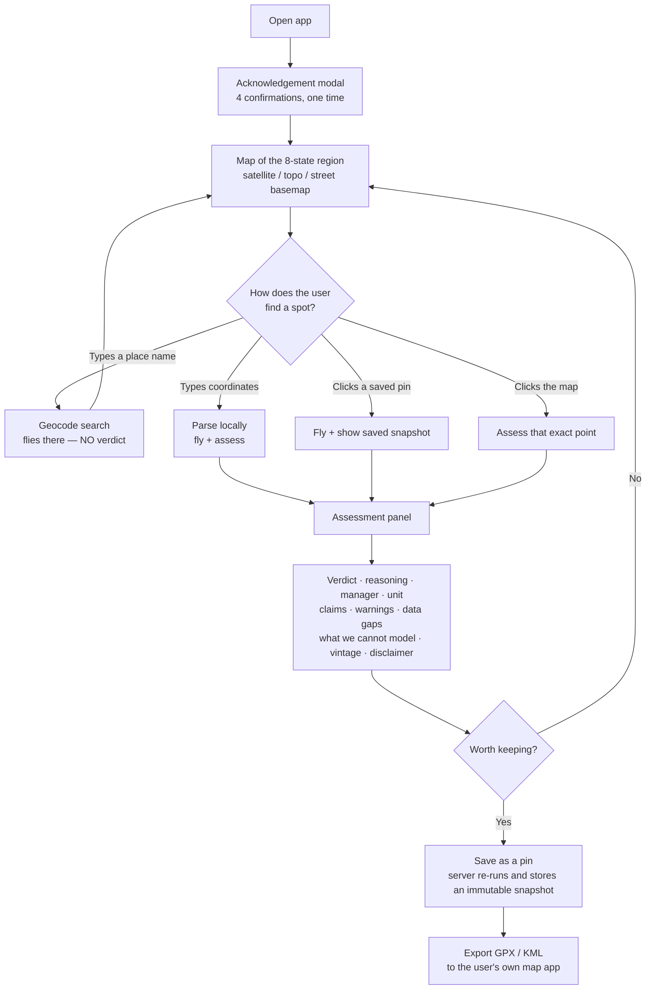
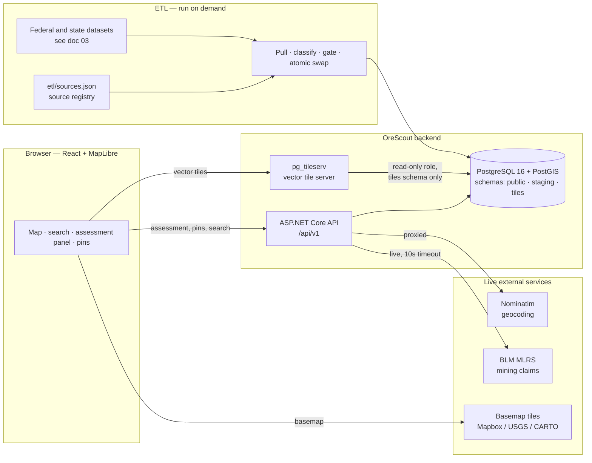
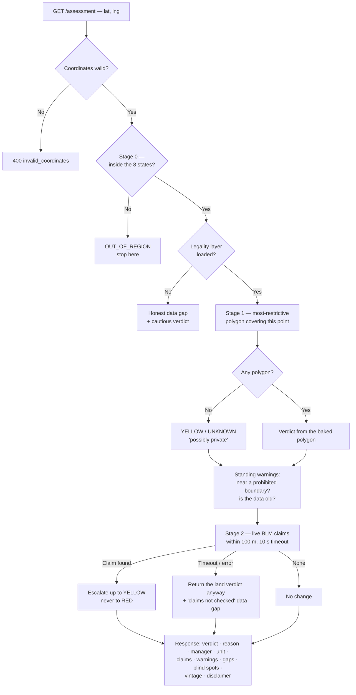
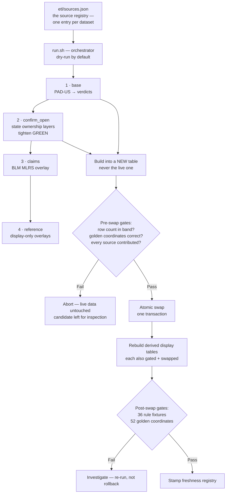

# OreScout — Application Overview

**Audience:** internal stakeholders, new team members, and anyone who needs to understand what OreScout is, how it works, and why it was built the way it was — without reading the codebase.

**Status of this document:** describes the application **as built on 2026-08-20**. Where something is planned rather than built, it is labelled. Derived from `PROJECT_PLAN.md`, the pre-production review docs, and — where documentation and code disagreed — from the source code itself.

**Companion documents:**
- [`02-legality-engine.md`](02-legality-engine.md) — how the legal verdict is actually decided, and every safety check behind it.
- [`03-external-data-sources.md`](03-external-data-sources.md) — every external dataset and service the product depends on.

---

## 1. What OreScout is

OreScout answers **one question**:

> **"Can I legally collect rocks / pan for gold / prospect *here*?"**

A user opens a map of the western United States, clicks a spot, and gets a plain-language verdict — **Open**, **Ambiguous**, **Possibly private**, or **Prohibited** — with the reasoning, the managing agency, any active mining claims nearby, and an explicit list of things the app *cannot* tell them.

### What it is not

Three boundaries are deliberate and load-bearing, not disclaimers bolted on afterwards:

| It is | It is not |
|---|---|
| A **planning and research tool used at home**, before a trip | A field-navigation app. Users research a spot, save it, then export the coordinates to their own map app (GPX/KML) |
| A **decision-support tool** that summarises public land data | A legal authority. Every result carries "verify with the managing agency" |
| Scoped to **casual hobbyist use** — hand panning, sluicing, surface collecting | A tool for commercial extraction or mechanised equipment. Users must acknowledge this before the app will open |

### Who it is for

- **Today:** amateur miners, prospectors, and rockhounds. The proof-of-concept runs single-user, for the product owner.
- **Committed direction:** a **public, multi-user product with accounts** (recorded as decision #29). The proof-of-concept remains single-user, but the architecture was built to be "public-compatible" from the start — versioned API, swappable auth middleware, a schema ready for a `user_id` column. The stated intent is that going public is *a forward migration, not a rebuild*.

### Where it works

**Eight western states: Nevada, California, Arizona, Colorado, Utah, New Mexico, Oregon, Idaho.**

A click outside those states returns a distinct `OUT_OF_REGION` result rather than a verdict, and the map greys out every unsupported state. This is deliberate: an unsupported area must never be confused with "we looked and found nothing," which is a very different message.

---

## 2. The user journey

### The acknowledgement gate

Before anything else, a modal titled **"Before you start"** requires four confirmations:

1. You will not operate mechanized or motorized equipment (no suction dredges, excavators, bulldozers, or similar) based on guidance from this app.
2. You will not conduct commercial mining or extraction based on data from this app.
3. This app is not legal advice — you are responsible for verifying current land-use rules with the relevant managing agency before visiting any location.
4. Data may be out of date. Land status, claims, and restrictions change. Always verify before you go.

Acceptance is stored locally along with a **version string**. Bumping the version forces every user to re-accept — so if the wording ever changes materially, prior acceptance does not silently carry over.

### Search behaves differently depending on what you typed

This is one of the more subtle product decisions and it is worth understanding. The search bar returns three kinds of result, ranked in this order:

| You typed | Result | Behaviour |
|---|---|---|
| **Coordinates** (decimal or DMS) | 📍 parsed instantly, locally | Flies to zoom 12 **and assesses** |
| **A saved pin's title** | 📌 up to 3 matches | Flies to zoom 13 **and assesses** that point live |
| **A place name** | 🔎 in-region geocoded places (about five visible, scrollable) | Flies to zoom 11 and **shows a hint: "Flew to X — click the map to check a spot"** — no verdict |

*(Note the difference between the two ways of reaching a pin: **searching** a pin's title runs a fresh live assessment at that point, while **clicking a pin in the My Pins list** opens its saved snapshot. Both are deliberate.)*

A place-name search deliberately produces **no verdict**. The reason is a real incident: a geocoded town centroid is an approximate point the user did not actually point at, and stamping a legal verdict on it is exactly the false confidence the whole product guards against. The project's known false-GREEN at Alta, Utah originated from a geocoded centroid landing on mismapped federal land. Coordinates are precise; place names are not; the product treats them differently.

### The assessment panel

Everything the engine knows is surfaced in one panel, in this order:

1. Coordinates (5 decimal places)
2. **Verdict pill** — Open / Ambiguous / Possibly private / Prohibited / Outside region
3. Plain-language guidance first; the raw agency code demoted to a muted `Basis:` line
4. Facts: managing agency, unit name, protection status
5. **Mining claims** — either a list of claim serial numbers hyperlinked to the BLM's own case-detail site, "No active mining claims within 100m," or "not checked (see notes)"
6. ⚠ **Warnings** — e.g. "Near boundary of X — verify your exact location"
7. ℹ **Data gaps** — honest "we could not look" notices
8. **"Not modeled — verify separately: …"** — a permanent list of known blind spots, visible by default (it used to be collapsed behind a click; that was changed on the principle that *blind spots should be visible by default*)
9. Data vintage and the standing disclaimer

### Saved pins

Saving a location sends only `{lat, lng, title, notes, status}` to the server. **The server then re-runs the assessment itself and stores the canonical result** as an immutable snapshot. Two reasons: the snapshot cannot be tampered with by a client, and it is guaranteed fresh even if the user sat on the panel for an hour.

Re-opening a pin shows **the snapshot as saved** — never a silently updated verdict. In the background the app re-checks live, and if the status has changed it shows a **drift banner**: *"Status may have changed since you saved this — Saved as [X] → now [Y]."* If the live re-check itself fails, it says so rather than staying silent.

There is deliberately **no "refresh snapshot" button**. Since every open already fetches live, a refresh button would only overwrite the snapshot and destroy the provenance that is its entire purpose. Re-baselining means delete and re-save.

Pins export as **GPX** or **KML** for the user's own navigation app, and are auto-tagged server-side (e.g. `BLM`, `National Forest`, `Possibly Private`, `Active Claim Nearby`).

---

## 3. The map layers

The map is the product's centre of gravity. Eight overlay families are served from OreScout's own infrastructure as vector tiles; the ninth — the out-of-scope mask — is a small boundary file bundled with the app.

| Layer | What it shows | Default | Notes |
|---|---|---|---|
| **Prohibited** (solid red) | Land the engine says is closed | **on** | The only solid fill in the whole design |
| **Ambiguous** (grey cross-hatch) | Recognised designations with their own rules; unconfirmed-open land | **on** | Hatched, over a solid grey base |
| **Confirmed open** (green) | Affirmatively confirmed open public land | off | Off by default so the map does not read as an invitation |
| **Active mining claims** (orange) | ~497,000 BLM claim polygons | off | z≥9 |
| **Waterways** (blue) | Streams and rivers, perennial solid / intermittent dashed, with downstream flow arrows | off | z≥10, arrows z≥12 |
| **Gold occurrences (MRDS)** | ~55,500 historic gold sites, ~28,500 of them recorded producers | off | z≥8. Labelled as historic, pre-2011 |
| **Prospecting potential** | ~18,000 scored markers: filled star / hollow star / diamond | off | z≥7 High, z≥10 Moderate |
| **Access & trails** | ~302,000 road and trail segments, split into Drive / Off-road / Hike-in | off | Trails z≥9, roads z≥10 |
| **Out-of-scope mask** (grey) | Every state outside the supported 8 | on | Not a tile — a bundled boundary file. Greys nothing until the supported-state list loads |

### The visual grammar is locked

**Solid = definitive. Hatched = cautionary.** Red is the only solid fill; every uncertain state is hatched, so the texture itself signals *do not treat this as final*. This convention is a locked decision that binds all future cautionary overlays.

### Three fail-safe rendering rules

The overlay design assumes that at some point something will fail, and every failure is engineered to degrade toward *visible* rather than toward *falsely open*:

- **A missing icon can't hide a warning.** Every symbol layer sits on top of a plain fill or circle layer. If a hatch pattern or a star glyph fails to load, you get a solid grey wash or a dot — not invisible ground.
- **An unknown verdict is loud.** Any verdict value outside `{RED, YELLOW, GREEN}` renders in bright magenta. On clean data it draws nothing; on a data bug it screams.
- **A failed tile is announced.** If overlay tiles fail to load, the app shows *"⚠ Some map overlay data failed to load — areas may be missing their red/grey shading."* A blank overlay reads as "open," which is the single most dangerous failure mode in the product.

### Two zoom tiers

Below zoom 9 the map draws a pre-generalised copy of the legality layer; at zoom 9 and above it draws the full-resolution version. This exists because full-detail tiles at state-wide zoom overran the tile server's timeout, returned HTTP 500, and **restricted land silently rendered blank**. The generalised tier fixed the performance problem; the fail-loud tile error handler covers the case anyway.

---

## 4. Architecture

### The components

| Component | Technology | Role |
|---|---|---|
| **Web app** | React · Vite · TypeScript · MapLibre GL JS | The entire user interface. Server state via TanStack Query, UI state via Zustand |
| **API** | ASP.NET Core (.NET 10), C# | Assessments, pins, geocode proxy, metadata, health, entitlements |
| **Database** | PostgreSQL 16 + PostGIS 3.4 | Holds every spatial dataset, the classifier rules (as SQL functions), and user pins |
| **Tile server** | pg_tileserv | Serves map overlays as vector tiles straight from PostGIS |
| **ETL** | Bash + GDAL/ogr2ogr + jq + psql | Pulls external data, classifies it, gates it, swaps it into place |

### Three database schemas, and why

| Schema | Contains | Who can read it |
|---|---|---|
| `public` | User pins, application metadata, the data-source freshness registry, the supported-region boundaries | The API only |
| `staging` | Raw external data as pulled, plus intermediate build products | The ETL only |
| `tiles` | The finished, precomputed map layers | The API **and** the tile server |

The tile server connects as a dedicated **read-only role that can only see the `tiles` schema**, with permissions on the `public` schema explicitly revoked. This is a deliberate safety boundary: **user location data can never be accidentally published as a public map tile**, even if someone adds a table to the wrong schema.

### What is precomputed vs. what is live

This split is the single most important architectural fact about the system.

| Precomputed by ETL, served as tiles | Computed live, per request |
|---|---|
| Every legality polygon and its verdict | The point-in-polygon verdict lookup (sub-millisecond, local) |
| The claims overlay (nightly snapshot) | **The mining-claims check** (live call to BLM) |
| Waterways, gold occurrences, prospecting markers, access routes | Geocoding (proxied, cached 24 h) |
| | Near-boundary and stale-data warnings |

The legality rules are applied **once, at build time**, and the verdict is baked into a single table that **both the map tiles and the assessment endpoint read**. This is decision #14, and it exists for one reason: **the coloured overlay and the clicked verdict cannot diverge.** Before it, manager-based prohibitions rendered no red on the map — the map said one thing and the click said another.

The one deliberate exception: the claims *overlay* is a nightly snapshot and can be up to a day stale, while the claims *verdict* is queried live on every click. The reasoning is recorded plainly — the fresher of the two is the one that gates a go/no-go decision.

### What happens when you click the map

Two details worth knowing:

- The polygon lookup uses a **boundary-inclusive** spatial test. A GPS point sitting exactly on a Wilderness boundary resolves to the *most restrictive* answer rather than falling through to the open land next door.
- If the database is unreachable, the API returns **503 with a retry hint** — it never fabricates a verdict. If the BLM claims service is unreachable, the land verdict is still returned, flagged as a partial result. The distinction is deliberate: PostGIS is our own infrastructure and without it there is no answer to give; BLM is a third party and its absence should not blank the whole product.

### The API surface

Everything sits under `/api/v1` and requires an API key except the health check.

| Endpoint | Purpose |
|---|---|
| `GET /health` | PostGIS (hard dependency → 503 if down) and the tile server (soft — reported as `down` while the overall status stays `ok`) |
| `GET /meta` | Data vintages, supported states, per-source freshness, whether the region gate is active |
| `GET /geocode?q=` | Place-name search, proxied to keep the provider swappable |
| `GET /assessment?lat&lng` | **The core endpoint.** Returns the full verdict object |
| `GET/POST/PUT/DELETE /pins` | Saved locations |
| `GET /pins/{id}/export?format=gpx\|kml` | Waypoint export |
| `GET /entitlements` | Which features this user may use |

Every error is a consistent `{ error: { code, message } }` shape. The 5xx taxonomy is deliberate: **a dependency being unreachable returns 503 with `Retry-After`; a bug in our own query returns 500.** Operators can tell "the internet is broken" from "we are broken" without reading logs.

---

## 5. The ETL pipeline

External data is not queried live — it is pulled, classified, verified, and swapped into place. The design goal is that **adding a new state should be a configuration change, not an engineering project.**

### The registry is the single source of truth

Every per-state parameter — the endpoint, the fields, the predicate that decides what counts as public land, the buffer distance, the coordinate system, the licence, the refresh cadence — lives in one JSON file. Exactly one small library knows the file's shape; nothing else reads it directly.

**The invariant, stated as a locked guarantee:** adding a state is *one registry entry* (plus a small rules mapping only if that state uses new attribute vocabulary). The engine, the tiles, and the frontend never change. If onboarding a state ever requires touching the engine, the abstraction has been violated and the fix is to the abstraction, not the engine.

### Four source roles

| Role | What it may do |
|---|---|
| `base` | Produce the RED/YELLOW/GREEN verdict. Currently exactly one source: PAD-US |
| `confirm_open` | **Tighten** GREEN — never create it. One per state |
| `claims` | Feed the claims overlay |
| `reference` | Display-only overlays that **can never change a verdict** — by construction, they own their own table and are absent from the verdict pipeline |

The `reference` role is how the product adds "where is it worth looking?" features (gold occurrences, prospecting potential, access routes) without any risk of those features leaking into "is it legal?"

### Every build is atomic

The shared refresh library gives every job the same five guarantees:

- **A lock**, so two runs can never overlap.
- **A schema assertion**, so a silently-changed upstream schema fails loudly.
- **A count gate** — the new table must be non-empty and within a tolerance band of the live one. This is what stops an upstream outage from returning near-empty data and silently blanking an overlay.
- **An atomic swap** — build into a new table, verify, then rename in a single transaction. The live table is never mid-rebuild.
- **A freshness stamp**, written *only* on success.

**The contract: any failure exits non-zero with the live table untouched.** The failed candidate is left on disk for inspection.

This was not free. An earlier version ran the rebuild directly against the live serving table, which meant that for several minutes during every rebuild the app served *open* over roughly 15,000 km² of land that should have been cautionary — and a mid-run failure left it that way indefinitely. That class of bug is what the atomic-swap design exists to prevent.

### Refresh cadence: three classes

| Class | Sources | Policy |
|---|---|---|
| **1 — nightly, fully automatic** | Mining claims | High churn, low schema risk. Wholesale replace, mechanically gated |
| **2 — periodic, fully automatic** | Utah ownership (quarterly), CAL FIRE (semi-annual) | Same-shape re-pulls, gated |
| **3 — versioned, human-approved** | PAD-US, geochemistry, watersheds | These change schemas and code vocabularies between releases. Automation *detects, prepares and verifies*; a person approves the swap |

The reasoning for class 3 is recorded bluntly: *"Blindly auto-swapping the legality base or the fixture-pinned prospectivity substrate is how you get a confidently-wrong map."*

A read-only watcher checks upstream sources for new releases without downloading anything, and a due-check runs the class-1 and class-2 jobs that are past their cadence. **There is currently no scheduler** — see §8.

---

## 6. Why it was built this way

The project keeps a numbered decisions log. The ones that shape the product most are below; the numbers are the project's own.

### Product doctrine

**#30 — "GREEN must be earned." (The most consequential decision in the product.)**
The engine asserts *open* only on land it has affirmatively confirmed is open public land. Everything it cannot confirm — private, state, tribal, unknown, no data at all, conflicting sources — defaults to cautious. GREEN means *"we confirmed this is open,"* not *"we found no red flag."*

This reframed the entire data strategy. The obvious approach is to acquire authoritative private-land data and mark it prohibited — which is expensive, county-by-county, and often licensed. Instead: **we do not need to enumerate private land.** Making the *public/open* determination accurate is cheap, and everything else defaults safe. The residual risk becomes "over-claimed open," which is measurable and fixable.

**#21 — Two kinds of uncertainty, not one.**
"Ambiguous" and "no data" are different messages and were split in the data model from day one:
- *Ambiguous* (a recognised designation with its own rules) → "it's a National Monument; look up that monument's rules" → lean **proceed with research**.
- *Possibly private* (no record at all) → "most often unmapped private land" → lean **stay out**.

**#16 — An active mining claim escalates to caution, never to prohibited.**
Two reasons: a recorded claim conveys mineral rights but does not by itself bar all casual hobby collecting; and hard-prohibiting a 100 m buffer around ~567,000 claims would paint enormous areas red and destroy the map's usefulness.

**#22 — Solid means definitive, hatched means cautionary.** Locked, and binding on all future overlays.

**#40 — Search resolves by intent.** Coordinates get a verdict; place names only navigate. See §2.

**#41 / #42 — Prospecting intelligence is display-only.** The "where is it worth looking?" layer has, by construction, zero effect on "is it legal?" The engine is commodity-generic; gold is simply the first commodity configured.

### Architecture

**#2 — Ingest and serve our own tiles, from day one.**
The alternative was proxying government map services live. Rejected for four stated reasons: the overlays *are* the value proposition; government map services **cannot be restyled** into our red/grey-hatch grammar; hosting our own costs only ~$15–25/month; and building the proxy first then migrating would mean doing the frontend overlay work twice.

**#14 — One unified legality layer.** Rules applied once at build time, verdict baked into one table read by both the tiles and the API. The map and the click cannot disagree.

**#31 — Per-state source registry.** Different states have genuinely different best-available data. The registry lets that be true *without the system being different per state.*

**#28 — The BLM Surface Management Agency cross-check was evaluated and dropped.**
The original plan was to cross-check PAD-US against BLM's national SMA layer. Real data killed it: that layer has **518 dissolved blocks for eight states**, against PAD-US's ~75,000 detailed features. Cross-checking against something that coarse would have bled coarse private/tribal blocks over fine open-BLM polygons and produced *false prohibitions*. Detailed per-state SMA layers were adopted instead, later, as the confirm-open layer.

**#35 / #43 — Bulk downloads replaced the live data pull.**
PAD-US was originally pulled from a live government query API. That API rate-limits bulk extraction and throttled the pull mid-run. Ingest moved to authoritative per-state bulk downloads (~1.5 GB for eight states). This was initially recorded as a manual annual step; it was later re-tested, found to be fully scriptable, and automated — with the *swap* still human-approved.

**#12 — Deliberate asymmetry in failure handling.** Our own database failing = fail the whole call with 503. A third-party service failing = return a partial result with an honest gap.

**#45 — The paywall seam was stubbed before it was needed.**
A no-op entitlement check routed through the code from day one, because retrofitting entitlement checks after features scatter across a codebase is surgery. All seven features are currently free. A key architectural finding is recorded: **the API is a clean chokepoint but map tiles bypass it**, so per-layer gating will need an authenticated tile proxy — for which the frontend already routes every tile URL through a single configuration point.

**#11 — Honest about the current auth model.** A single static API key, appropriate for a private proof-of-concept. The plan states plainly that the key is baked into the client bundle and *"is not a security control"* once public; migration to proper accounts is a middleware swap.

### Decisions driven by things going wrong

Several decisions exist because something failed in a way that mattered:

- **#38** — full-detail tiles at low zoom overran the tile server, returned errors, and **prohibited land rendered blank**. Fixed with a generalised low-zoom tier, plus a fail-loud error banner, on the principle that *absence of overlay must never read as "open."*
- **#36** — applying "GREEN must be earned" at the margins: permitted-use recreation areas (ski resorts, campgrounds, summer-home tracts), geological special-designation areas, and archaeological/historic areas all stopped earning GREEN. Roadless areas, National Grasslands and National Scenic Trails deliberately **stayed** GREEN — they restrict mechanised travel and development, not hand-tool collecting.
- **#37 / #44** — a plain 100 m "adjacent to public land" buffer was forgiving private inholdings next to national forest. The fix generalised to all eight states and became a parameterised carve-out — still zero per-state code.
- **#34** — the dev API port moved off 5000 because macOS AirPlay silently squats it and breaks browser preflight requests. Chosen over asking every developer to toggle a system setting, as "more honest for the eventual deploy."

---

## 7. Tech stack and operations

| Layer | Choice |
|---|---|
| Backend | ASP.NET Core / C#, .NET 10, minimal APIs |
| Database | PostgreSQL 16 + PostGIS 3.4 |
| Tile server | pg_tileserv — chosen over Martin because it auto-exposes PostGIS tables with zero configuration, which suits a single-developer project |
| Frontend | React · Vite · TypeScript · MapLibre GL JS · TanStack Query · Zustand |
| ETL | Bash · GDAL/ogr2ogr · jq · psql |
| Basemaps | Mapbox Satellite (default) · USGS Topo · CARTO Voyager |
| Geocoding | Nominatim (OpenStreetMap), proxied through our API |
| Claims | BLM MLRS, live query + nightly bulk ingest |

**Today:** Postgres and the tile server run in Docker; the API and web app run natively. **Nothing has been deployed** — everything runs on a local development machine.

**Planned deployment (costed, not built):** Azure — App Service or Container Apps for the API, Azure Database for PostgreSQL for the data, Static Web Apps for the frontend. Estimated ~$16/month for the database and $0–15/month for the API tier.

---

## 8. Where the product actually stands

### Built and verified

- **Eight states fully loaded and classified.** ~86,900 protected-area features classified into ~232,600 legality polygons.
- **~497,400 mining claims** ingested for the overlay, plus a live per-click claims check.
- **~55,500 historic gold sites**, ~18,000 prospecting-potential markers, ~302,300 access segments, and a full waterways network.
- **A substantial regression suite**, all green at the last full run: 36 rule fixtures, 52 golden coordinates checked against both the live API and the baked data, 213 frozen private-parcel goldens, plus atomicity, freshness, display-sync and upstream-canary checks.
- **A statistically-framed private-land validation.** A stratified sample of 1,504 private parcels in Colorado, New Mexico and Utah: **zero returned "open,"** with a Clopper–Pearson 95% upper bound of 0.245% against a 0.5% launch gate.

### Known gaps, stated honestly

The July 2026 pre-production audit is worth quoting, because it is the most important sentence in the project's own documentation:

> *"Every committed regression gate is green (except the known-stale mlrs_claims freshness gate), and yet Round 1 constructed live false-GREENs in 7 of 8 states — the harnesses' blind spots are themselves part of the findings."*

Most of what that audit found has since been fixed. What remains open:

| Gap | Impact |
|---|---|
| **Cross-border land is judged by the wrong state's authority** | ~730 km² of ground. Designed fix, not built. Classified critical, deferred |
| **A parcel-data correction is blocked** | An owner-classification bug is fixed in code but cannot be applied to the data, because doing so would currently *strip* protection from city, county and tribal parcels. Tribal land must never read as open |
| **Historic sites with no data signal** | A USFS-owned fee-managed historic site returns "open." Confirmed unfixable with current data; needs a dataset the product does not yet have |
| **The strongest safety check is not automated** | The gate that tests the property the app actually promises — "does any known not-public ground return open?" — is a manual tool wired into nothing |
| **Nothing is scheduled** | The nightly claims refresh is hardened but runs by hand. Scheduling is blocked on having a network-reachable database, which means deployment |
| **The geocoder is a launch blocker** | The public OpenStreetMap geocoding instance's usage policy prohibits exactly what a public OreScout would do to it. Alternatives are priced; the swap is a configuration change because the geocoder is proxied |
| **No CI, no deployment, no security review** | The test suite runs by hand. Nothing has ever been deployed |

**The honest headline number:** across 113,037 sampled points on known not-public ground, **18 above the meaningful-parcel size floor still return "open" — 0.016%.** Product copy should say *"zero on the validation sets, with a measured residual of 18 in 113,037 sampled points"* rather than "zero false positives." Most of that residual is the cross-border issue above, not a flaw in the rules themselves.

### Where it goes next

**Near term — the path to a public launch:**

1. Deploy to a hosted environment (this unblocks scheduling, CDN, and the whole class-1/class-2 refresh automation).
2. Close the cross-border carve gap and unblock the parcel correction.
3. Replace the geocoder.
4. Wire the output-property safety gate and the fixture suite into continuous integration.
5. User accounts, so pins belong to people.
6. Terms of service, privacy policy, and a legal review of the product's disclaimers.

**Designed, deferred:**

- **A "possibly private" map overlay.** Currently the *possibly private* verdict has no map colour — deliberately, pending evidence that inholdings are common enough to warrant one. The validation data now argues that they are, and the decision is flagged for revisit.
- **Access routing** — "what's the best way to actually get there," building on the existing access network.
- **An iOS client**, thin over the same API.
- **More states** — which, if the registry invariant holds, is one JSON entry each.

---

## 9. A note on reading the older documents

If you go into the repository's engineering docs, be aware that several of them have drifted:

- `README.md` still describes the PAD-US version, polygon counts, and claim counts from an earlier era, and refers to a "PAD-US 4.2 upgrade." **There is no PAD-US 4.2** — 4.1 is current, and the "4.2" label was anticipatory. Do not put it in stakeholder material.
- `PROJECT_PLAN.md` is the stated source of truth for design intent and the decisions log, and is excellent for *why*. For *what the system does today*, prefer the code and the pre-production review documents.
- Several fixture and row counts appear in multiple documents with different values. The most recent audit run wins.

This document, and its two companions, were written by reading the code where documentation and implementation disagreed.
