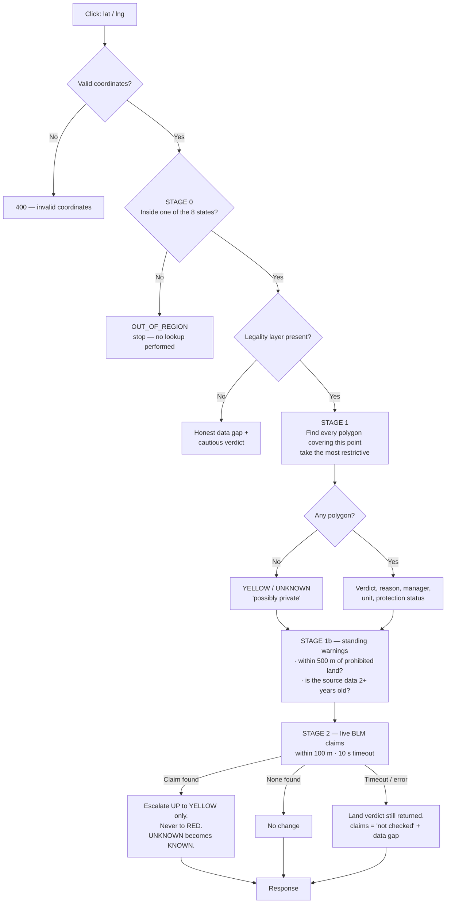
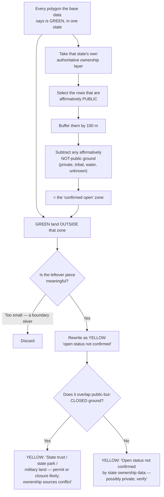

# OreScout — The Legality Engine

**Audience:** internal stakeholders and new team members who need to understand exactly how OreScout decides that a place is open, decides that a place is off limits, and guards against telling someone "yes" when the answer is "no."

**Status:** describes the engine **as built on 2026-08-20**. Written from the source code; where documentation and implementation disagreed, the code is what is described here, and the disagreement is noted in §9.

**Companion documents:** [`01-application-overview.md`](01-application-overview.md) · [`03-external-data-sources.md`](03-external-data-sources.md)

---

## 1. The one idea that explains everything

> **GREEN must be earned.**

The engine asserts *open* only on land it has **affirmatively confirmed** is open public land. Everything it cannot confirm — private, state, tribal, unknown ownership, no data at all, or sources that disagree — falls back to cautious.

The phrasing matters:

- **GREEN means "we confirmed this is open."**
- **GREEN does not mean "we found no red flag."**

This is the inverse of the intuitive design, and it has a structural consequence that is the single most important safety property in the product:

**The only thing in the entire system that produces GREEN is a managing agency of BLM or US Forest Service.** No other input can create it. A private parcel can therefore only be shown as open if a data source *actively mis-codes it as BLM or Forest Service land*. Missing data cannot produce a false "open" — it produces no polygon at all, which produces caution.

The dangerous case requires the data to be **wrong**, not merely **incomplete**. That is a much smaller and much more measurable risk surface, and it is why the product does not need to buy a nationwide private-land cadastre in order to be safe.

---

## 2. The verdict model

The engine returns one of four statuses. Two of them carry a second field that distinguishes *two very different kinds of uncertainty*.

| Status | Second field | What the user sees | What it means |
|---|---|---|---|
| **RED** | — | **"Prohibited"**<br/>*Do not prospect or collect here.* | A protected designation, private or tribal ownership, or a managing agency that is closed to casual collecting |
| **YELLOW** | `KNOWN` | **"Ambiguous"**<br/>*This is a recognized designation with its own rules (permits are common). Contact the managing agency for this unit's collecting policy before you go.* | We know exactly what this land is; we cannot model its specific rules |
| **YELLOW** | `UNKNOWN` | **"Possibly private"**<br/>*No public-land record covers this spot — most often that means unmapped private land. Verify ownership before entering, and lean toward staying out.* | We have **no record at all** for this point |
| **GREEN** | — | **"Open"**<br/>*Generally open for casual hobby use.* | Affirmatively confirmed open public land, with no state ownership layer contradicting it |
| **OUT_OF_REGION** | — | **"Outside region"**<br/>*Legal overlay data is not available here.* | Outside the eight supported states. No lookup was performed |

### Why the two yellows are split

They point users in **opposite directions**, and collapsing them would be a real product failure:

- `KNOWN` says *"it's a National Monument — go look up that monument's rules."* Lean toward **researching and proceeding**.
- `UNKNOWN` says *"there is no record here, which most often means unmapped private land."* Lean toward **staying out**.

The distinction also drives the automatic pin tag (`Possibly Private`) and, in future, a distinct map colour.

### The fail-safe

If the API ever returns a status the user interface does not recognise — because the API shipped ahead of the frontend, or a saved snapshot is from an older version — the panel renders the label **"Unknown status"** above *"Unrecognized status — verify the rules independently with the managing agency before you go."* It never crashes and never shows a blank panel.

### "Most restrictive wins," everywhere

Every place in the system where two answers must be combined uses the same ranking:

```
RED (3)  >  YELLOW (2)  >  GREEN (1)  >  no signal (0)
```

Overlapping land features, two data sources disagreeing, the confirm-open overlay sitting on top of a base verdict, the map's display layer deciding what colour to paint — all of them reduce to *take the maximum*. There is one ranking function in SQL and a mirror of it in the API code, and they agree.

**Rank 0 means "no signal," and no polygon is written at all.** That is what produces the *possibly private* answer at request time.

---

## 3. The decision pipeline



### Stage 0 — the region gate

**Why it runs first.** Without it, a click in Texas would find no polygon and fall into the *possibly private* path — which reads as "we looked and found a data gap." That is a materially different and misleading message from "we do not cover this area."

The gate uses a **boundary-inclusive** spatial test. A GPS point exactly on the Nevada/California line sits on the *boundary* of both state polygons; a boundary-exclusive test matched neither and returned a spurious "outside region."

**Known failure mode:** if the supported-region table is ever empty — a failed load, an accidental truncate — the gate **passes everything**. This is a documented development convenience with a real production risk. It is bounded (an out-of-region point matches no legality polygon, so it resolves cautious, never open) and it is surfaced: the `/meta` endpoint exposes a `regionGateActive` flag specifically so this cannot fail silently.

### Stage 0.5 — the layer-existence probe

Before querying the legality table, the engine checks it exists. If it does not, the response carries an explicit data gap — *"Legality layer not yet ingested … verdict is provisional"* — and takes the cautious path. The principle in the code comment: **be honest, don't fabricate.**

### Stage 1 — the polygon lookup

Find every polygon in the baked legality table that covers the point, order by restrictiveness, take the top one.

Two deliberate choices:

- **Boundary-inclusive again.** A point exactly on a Wilderness or Wilderness Study Area edge resolves to the restrictive answer rather than falling through to the surrounding open land.
- **Most-restrictive-of-all-overlaps.** Protected-area data stacks designation and ownership features on top of each other. A confirm-open cautionary polygon sits *on top of* an open base polygon and wins.

**No polygon found → cautious with `UNKNOWN`.** *"No land-management data here — treat as possibly private; verify ownership before entering."*

**If the database fails**, the engine returns an error, never a verdict. A connection-level failure returns 503 with a retry hint; a query bug returns 500. PostGIS is our own infrastructure — if it is down there is genuinely no answer to give, and inventing one would be the worst possible behaviour.

### Stage 1b — standing warnings

Two warnings are appended regardless of verdict:

1. **Near a prohibited boundary.** If the point is not itself prohibited but the nearest prohibited unit is within **500 m**, the response warns *"Near boundary of X — verify your exact location."* This is skipped when the point is already prohibited, because a naive version once named the very unit the user was standing inside.
2. **Stale source data.** If the underlying land-status data is two or more years old, the response says so. Given the current data vintage, **this warning fires on every result today.**

### Stage 2 — the live mining-claims check

The engine queries BLM's live "not closed" mining-claims service for any claim within **100 m** of the point.

- **100 m, not zero,** because claim polygons are PLSS survey aliquots with real gaps between them; a raw point-intersect frequently returns nothing when a claim is plainly there.
- **10-second timeout**, enforced strictly.
- **Successes cached for an hour**, keyed to a ~110 m grid matching the buffer. **Failures are never cached**, so recovery is immediate.
- **The "success that isn't" is handled.** The upstream service returns errors as HTTP 200 with an error body. The code checks for that explicitly rather than reading it as "zero claims."

**The escalation rule — this is important and frequently misunderstood:**

> A recorded claim escalates the verdict **up to YELLOW, and never further**. It never lowers a verdict. It never produces RED.

An existing RED keeps its verdict; the claim only adds a warning. An existing *possibly private* becomes *ambiguous* — because a recorded federal mining claim proves federal mineral estate, which resolves the "we have no record" state. In that specific case the user gets a **split-estate** message: the claim confirms federal minerals, but the *surface* owner is still unknown, and both need verifying.

Two reasons for the cap at YELLOW:
1. A recorded claim conveys **mineral rights**, and does not by itself bar all casual hobby collecting.
2. Hard-prohibiting a 100 m buffer around roughly 567,000 claims would paint enormous swathes of the map red and destroy its usefulness.

**On failure, the land verdict is still returned** with `activeClaims: null` and an honest gap: *"Mining claims data temporarily unavailable. Verify active claims at reports.blm.gov before prospecting."* Since the claims check can only ever *escalate*, its absence cannot create a false "open" — but it **can hide a real claim**, which is why there is a dedicated canary check (§6.7).

Each claim found is rendered as its **serial number, hyperlinked to BLM's own case-detail report**, with the claim name, type and disposition. The claims service exposes no claimant name, so the deep link is how a user finds out who to contact.

---

## 4. How "open" is established

### The four conditions for GREEN

All of these must hold:

1. **The managing agency is BLM or US Forest Service.** This is the only source of GREEN in the system.
2. **No overlapping feature carries a prohibitive or cautionary designation** (the tables in §5).
3. **Ownership is not private or tribal** (prohibited), and not unknown or local (cautionary).
4. **The protection status is not a strict-protection tier.**

...and then, on top of all four:

5. **The state's own authoritative ownership layer confirms public land within 100 m of the point.**

### Three deliberate exceptions that stay open

Three designations that *sound* restrictive stay GREEN, and this is locked by test fixtures so it cannot be changed by accident:

| Designation | Why it stays open |
|---|---|
| **Inventoried Roadless Area** | Restricts mechanised travel and development — not hand-tool collecting |
| **National Grassland** | The underlying Forest Service land is open |
| **National Scenic / Historic Trail** | The trail corridor designation does not close casual collecting on the land it crosses |

### The confirm-open layer — how GREEN gets *taken away*

This is the mechanism that implements "GREEN must be earned," and it is worth understanding precisely, because it is counter-intuitive.

**The confirm-open layer never creates GREEN. It only subtracts it.**



**Three predicates per state**, all defined in the source registry, all reviewed judgements:

| Predicate | What it captures | Effect |
|---|---|---|
| `public_predicate` | Federal agencies — the land that genuinely confirms "open" | Forms the 100 m buffer |
| `nonopen_public_predicate` | State trust land, state parks, wildlife areas, county, city, military | **Public but not open.** Produces a distinct, more informative warning |
| `carve_private` *(optional)* | An explicit private / tribal / non-public expression, where a state's data supports one | Subtracted *back out* of the buffer, so adjacency never forgives a mapped private parcel |

**The second predicate is required.** The build generator refuses to run for a state without a `nonopen_public_predicate`, and fails with a long explanatory error. That guard exists because omitting it once shipped *"Managing agency BLM — generally open"* over Utah State Trust land, Colorado State Land Board sections, New Mexico State Trust and Department of Defense land, and Idaho endowment land.

**The third is optional, and mostly unused.** Only Utah sets it explicitly. For the other states the generator derives the not-public set **by complement** — everything the `public_predicate` does not affirmatively evaluate to true, which is why the NULL-handling detail in §6.1 matters so much. California is the exception in the other direction: it uses a hand-written build file that carves tribal and non-profit land directly.

**The sliver filter is deliberately asymmetric.** A leftover fragment is kept if it is larger than the state's size floor **or** if it overlaps more than 400 m² of known not-public ground **or** more than 400 m² of public-but-closed ground. The code comment states the principle: ***"extra YELLOW is safe, missing YELLOW is not."***

That disjunction is a fix, not a nicety. A raw size threshold alone was discarding real private land: a 2.6 km² Nevada parcel mapped as private was eroded by the buffer, chopped by internal processing lines, survived only as an 882 m² fragment, and was thrown away — leaving live "open" over mapped private land.

### California is the hard case, and is documented as such

California has no affirmatively-private ownership layer at all. The state's public-ownership dataset maps *public land only*, so private land is **absent** rather than **labelled**. The engine has to infer private by complement, which fails in one specific and predictable shape: **a private corridor narrower than about 200 m, flanked by national forest, sits entirely inside the 100 m forgiveness band regardless of how large it actually is.**

Real mountain villages — Mt Baldy, Forest Falls, Fawnskin, Alleghany, Downieville, Sierra City — have exactly that shape, and returned *"Managing agency USFS — generally open."*

The fix distinguishes a village from a boundary strip **by shape rather than size**: erode every leftover piece by 25 m and keep only the pieces that still have a core. Measured outcome — a 34,841 m² thin registration strip erodes to nothing and is correctly ignored, while Mt Baldy's 361,956 m² village keeps a 282,630 m² core and is correctly flagged.

The California build file states the residual honestly, and so should we:

> *"This does NOT make CA equivalent to the other states: without an affirmative-private layer, narrow private strips under ~50 m wide remain unprotected. Closing that needs CA parcel data."*

### One operational warning that belongs in this document

The base build step **drops and rebuilds the legality table using only the base data source**. Running it on its own therefore **silently reverts every confirm-open cautionary polygon back to open** — roughly 145,000 polygons covering thousands of square kilometres. This is a documented landmine with a loud warning in the repository, and the reason the rebuild is only ever run through the orchestrating script.

An earlier version of this pipeline made the problem worse: the rebuild ran directly against the **live serving table** in separate transactions, so for the minutes between the base rebuild and each state's confirm-open step, the app served *open* over every acre of confirm-open land — and a mid-run failure left it that way indefinitely. The current design builds into a separate table and only reaches production through a gated atomic swap.

---

## 5. How "off limits" is established

All attribute-to-verdict mapping happens in two pure SQL functions. They contain no geometry, are deterministic, and can be unit-tested with no data loaded at all — which is why the rule fixtures run in seconds and gate every build.

### 5.1 By designation and ownership

Evaluated top-down; the first match wins.

| # | Condition | Verdict |
|---|---|---|
| 1 | Designation is one of: `NP` `WA` `WSA` `NWR` `SP` `MIL` `RNA` `TRIBL` `SW` | **RED** |
| 2 | Ownership is `PVT` (private) or `TRIB` (tribal) | **RED** |
| 3 | Designation is one of: `NM` `ACEC` `NCA` `NRA` `SWA` `CONE` `WSR` `NSBV` `REA` `RANE` `HCAE` `REC` `SDA` `HCA` `LHCA` `SHCA` `RMA` `SCA` `UNKE` | **YELLOW** |
| 4 | Ownership is `UNK` (unknown) or `LOC` (local) | **YELLOW** |
| 5 | Protection status is tier 1 or 2 (strict protection) | **YELLOW** |
| — | otherwise | no signal |

**The prohibited designations, in plain English:**

| Code | Meaning |
|---|---|
| `NP` | National Park |
| `WA` | Wilderness Area |
| `WSA` | Wilderness Study Area |
| `SW` | State Wilderness |
| `NWR` | National Wildlife Refuge |
| `SP` | **State Park** |
| `MIL` | Military land or withdrawal |
| `RNA` | Research Natural Area |
| `TRIBL` | Tribal land designation |

**The cautionary designations, in plain English:**

| Code | Meaning | Why cautionary rather than open |
|---|---|---|
| `NM` | National Monument | Rules are set per-proclamation and vary enormously |
| `ACEC` / `NCA` / `NRA` | Area of Critical Environmental Concern / National Conservation Area / National Recreation Area | Unit-specific management plans |
| `SWA` | State Wildlife Area | State permit regimes |
| `CONE` | Conservation Easement | Third-party rights |
| `WSR` | Wild & Scenic River | Corridor-specific rules |
| `REC` | Permitted-use recreation area | **Ski resorts (including Alta/Snowbird), campgrounds, summer-home tracts.** Third parties hold rights here |
| `SDA` | Special Designation Area (geological/geothermal) | *Often designated precisely because collecting is restricted* |
| `HCA` / `LHCA` / `SHCA` / `HCAE` | Historic / cultural / archaeological areas | Federal archaeological-resources law territory |
| `RMA` | Mineral reserve area | |
| `SCA` | State conservation area | |
| `UNKE` | Unknown easement | |
| `NSBV` / `REA` / `RANE` | National Scenic-Botanical-Volcanic / Research & Education Area / Ranch Easement | Added in the most recent data release reconciliation |

Note **strict-protection tier 3 does *not* escalate** — only tiers 1 and 2 do. This is locked by a fixture.

### 5.2 By managing agency

| Verdict | Agencies |
|---|---|
| **RED** | `NPS` `FWS` `BIA` `TRIB` `ARMY` `NAVY` `USAF` `USMC` `USACE` `DOD` `DOE` `NTVALL` `NTVPIC` `PVT` |
| **YELLOW** | `ST` `LG` `USBR` `OTHFE` `OTHF` `UND` `UNK` `CITY` `CNTY` `REG` `RWD` `SDC` `SDNR` `SDOL` `SFW` `SLB` `SPR` `NGO` `NRCS` `OTHS` `OTHR` `UNKL` `JNT` `BOEM` `ARS` `NOAA` `BPA` |
| **GREEN** | `BLM` `USFS` — **and nothing else** |

Reading the less obvious codes: `NTVALL` and `NTVPIC` are native allotments; `SLB` is a State Land Board; `SDOL`, `SDNR`, `SDC`, `SFW` and `SPR` are state land, natural-resource, conservation, fish-and-wildlife and parks agencies. *(These expansions are the standard reading of the upstream agency vocabulary; the repository does not carry its own glossary for them.)*

### 5.3 Combining them

The two functions are evaluated independently and the **more restrictive wins**. If both produce "no signal," **no polygon is written at all** — which becomes *possibly private* when someone clicks there.

### 5.4 Real-world category cheat sheet

| Category | Verdict |
|---|---|
| National Park | RED |
| Wilderness / Wilderness Study Area (including inside a national forest) | RED |
| National Wildlife Refuge | RED |
| **State Park** | RED |
| Military range, withdrawal, or Department of Energy site | RED |
| Research Natural Area | RED |
| Tribal land | RED |
| Private land, where mapped | RED |
| National Monument | YELLOW |
| ACEC / National Conservation Area / National Recreation Area | YELLOW |
| State trust or state land board land | YELLOW |
| City / county / local government land | YELLOW |
| Land trust or NGO land | YELLOW |
| Strictly protected (tier 1 or 2) | YELLOW |
| Unknown ownership | YELLOW |
| State or local land that the base data mis-maps as federal | YELLOW *(caught by the confirm-open layer)* |
| **Unmapped private inholding** | YELLOW / *possibly private* — **because no polygon exists at all** |
| Open BLM or Forest Service land, confirmed by the state's own layer | GREEN |

---

## 6. Safety checks

The engine has a layered defence. Some checks block a build; some are advisory; one — the most important — is currently manual. That distinction is stated for each.

### 6.1 Conservative defaults (the foundation)

| Rule | Effect |
|---|---|
| **No data → cautious, never open** | The single most important property in the system |
| **Unmapped attribute → no polygon → cautious** | An attribute value the rules do not recognise writes nothing rather than defaulting to open |
| **NULL ownership counts as not-public** | A subtle one. An early version used a negation that evaluates to NULL for a NULL input, which silently dropped every unknown-ownership parcel from the protective carve. Measured impact when found: 21 of Nevada's 34 NULL-ownership polygons had scored open |
| **Unknown or local ownership never earns open** | |
| **Blank is safe; green is not** | Stated in the low-zoom build as *"Dropping GREEN is safe (blank land is not an affirmative claim of open); dropping RED/YELLOW is not."* So when the generalised map layer is built, open land is clipped against the **full-resolution** prohibited and cautionary layers before it is written |
| **Sliver-filter asymmetry** | *"Extra YELLOW is safe, missing YELLOW is not"* |
| **UI fail-safe** | An unrecognised status renders as "Unknown status — verify independently" |

### 6.2 The unmapped-code gate — **blocks the build**

Runs after every base-data release download, before any rebuild. It checks the newly loaded data against the live rules and **fails loudly** if it finds:

- a designation code the rules do not map, that is not on an explicitly reviewed "deliberately neutral" list
- a managing agency the rules do not know
- an ownership type outside the known vocabulary

**Why this matters more than it sounds:** an unmapped code is **not neutral**. A feature whose only signals are unrecognised falls through to agency-based classification, and if the agency is BLM or Forest Service, that means it **silently becomes open**. The gate also reports how many square kilometres would be affected, so the blast radius of a "no signal" is visible.

The most recent release bump surfaced **21 new designation codes**. Fifteen of them already resolved correctly via their managing agency or ownership type; the remainder needed a human decision, producing five new mappings (one prohibited, four cautionary) with two more reviewed and deliberately left open. The gate exits with *"do NOT run the rebuild until mapped."* Clearing it requires a reviewed edit to the rules.

### 6.3 The output-property gate — **the strongest check, and it is not automated**

Every other check tests an *input* or a *fixed set of known points*. This one tests **the property the app actually promises**:

> *Does any point on ground that a state's own data says is not-public return "open"?*

Method: take every polygon a state's authoritative layer says is not-public, clip it to that state's own boundary, sample an interior point from each, and score it **with the engine's own query**. Any sampled point on a polygon of at least 400 m² that scores GREEN is a failure.

Its own header explains why it exists:

> *"Every committed harness tests INPUTS (registry transcription, schema, row-count bands) or a fixed set of golden POINTS. None tests the property the app actually promises. That is how Round 1 of the pre-production audit constructed live false-GREENs in 7 of 8 states while every gate stayed green."*

**Measured result, most recent run (2026-08-18):**

| State | Above the 400 m² floor | Raw (incl. sub-floor slivers) | Sampled |
|---|---|---|---|
| CA | 4 | 13 | 33,868 |
| NV | 7 | 15 | 9,603 |
| CO | 1 | 337 | 11,414 |
| OR | 0 | 1 | 2,733 |
| UT | 2 | 14 | 12,170 |
| AZ | 3 | 5 | 14,290 |
| NM | 0 | 0 | 14,451 |
| ID | 1 | 10 | 14,508 |
| **Total** | **18** | **395** | **113,037** |

**0.016% above the floor.** The prior baseline was 0.881% raw on a smaller, less strict sample.

Three honest caveats, all stated in the tool itself:

- **It is a detector, not a proof of absence.** One interior point per polygon bounds nothing about the rest of a large polygon.
- **California is permanently the weakest state** for this gate, because its ownership layer maps no affirmative not-public geometry to sample.
- **It has an anti-silence guard.** If a state's sweep returns zero rows it reports *"BROKEN — a gate failure, NOT a pass."* That was added after a stray quote character terminated a shell string early and the gate cheerfully printed "0 of 0 sampled — clean" for all eight states.

**⚠ This gate is a manual tool wired into nothing.** It does not block a build. Automating it is the highest-value safety item on the roadmap.

### 6.4 Rule fixtures — **blocks the build**

**36 cases**, pure attribute-to-verdict, no geometry, no data. Each runs a tuple through the classifier and raises an exception on any mismatch.

Coverage: five of the nine prohibited designations (`NP` `WA` `WSA` `TRIBL` `SW`), thirteen of the nineteen cautionary ones, private and tribal ownership, unknown and local ownership, several prohibited managing agencies, the three deliberate open exceptions, both strict-protection tiers plus the tier that must *not* escalate, and the all-null case that drives the no-data path.

*Worth noting as a gap:* the fixtures do **not** individually cover `NWR`, `SP`, `MIL` or `RNA` on the prohibited side, or `NCA`, `NRA`, `SWA`, `CONE`, `LHCA` or `SHCA` on the cautionary side. Those codes are mapped correctly in the rules and are exercised indirectly by the golden coordinates (§6.5), but they have no dedicated unit-level fixture. Filling that out is cheap and worth doing.

They are fed from the current working copy rather than a container-mounted file, deliberately, so a build always tests *this checkout's* rules rather than a stale copy.

### 6.5 Golden coordinates — **blocks the build**

**52 real latitude/longitude points** of known type. For each one, the check asserts **two things**:

1. The **live API** returns the expected verdict.
2. The **baked data** returns the expected verdict when queried directly.

In other words, the API and the data must agree. A flip means either a unit was recoded upstream or a boundary moved — both of which the team wants to know about immediately.

Roughly two prohibited, two cautionary and one open point per state (Oregon has one prohibited), plus two no-data cases and two outside-region cases. The open points are deliberately chosen with no recorded mining claim within ~2 km, so a live third-party call cannot make the deterministic gate flaky.

A **pre-swap** variant of the same check runs against the not-yet-live candidate table, using the engine's own spatial predicate — on the principle that *a gate that certifies the engine must use the engine's predicate.*

### 6.6 Private-land validation, in two tiers

**Tier 1 — curated ground truth (16 points).** Known private inholdings and mountain townsites: Idyllwild and Wrightwood CA, Greer and Strawberry AZ, Ward CO, Brian Head UT, Cloudcroft NM, Jemez Springs NM, Government Camp OR, Atlanta and Stanley ID, Lamoille NV, Kohls Ranch and Cartwright Ranch AZ, Alta UT townsite, Grizzly Gulch UT. Every one must be non-open. **Result: 16 of 16 non-open, zero defects.**

**Tier 2 — a statistically framed parcel sample.** This is the production-rigour version and it is worth describing properly, because it is what a stakeholder should quote.

- **Frame:** private parcels of at least 400 m² whose interior lies within **2 km of BLM or Forest Service land** — the inholding case. Deep-urban private land is uninformative.
- **Design:** stratified by state × parcel size, proportionally allocated with a minimum of 25 per stratum, deterministically ordered so the sample is reproducible.
- **Scoring:** the engine's own query.
- **Statistic:** an exact Clopper–Pearson 95% upper confidence bound.
- **Gate:** upper bound below 0.5%, and every "open" hit individually reviewed.

**The validation earned its keep on the very first run.** It found **9 real false-"open" results** out of 1,504 parcels (0.60%, upper bound 1.13% — a fail). All nine were dispositioned as genuine private owners inside blocks that the survey-grade state ownership layers map as federal. That produced the parcel-grade carve. Three New Mexico survivors turned out to be 71 m² assessor artifacts, which is where the 400 m² "meaningful parcel" floor came from — recorded, not hidden.

**Final result: 0 of 1,504, upper bound 0.245%.** Pass.

**The honest scope caveat, which must travel with that number:** it covers **Colorado, New Mexico and Utah only** — the three states with parcel data loaded. Counties without parcel coverage carry the measured **~0.6% survey-resolution leak**. That number is, in the project's own words, *"the number that prices Regrid/county expansion"* — i.e. what it would be worth paying for commercial parcel data or for extending county coverage.

A third layer freezes **213 private-parcel goldens**, including six sentinels that were once false-"open" — so a regression on a known-bad case is caught immediately.

### 6.7 The upstream canary — advisory, exits non-zero

The claims service treats "zero features" as a legitimate *"no claims here."* So if BLM renames, moves, or re-schemas the layer, the API would return **200-with-no-claims forever**, and assessments would silently stop escalating. That is a failure that produces no error anywhere.

The canary fires the same query shape at a claim-dense sentinel location — Round Mountain, Nevada, with 23 verified active claims — and fails loudly on zero features, on an error payload, or on no response at all. Its failure message is deliberately alarming: *"The API is now silently reporting NO CLAIMS EVERYWHERE."*

### 6.8 Build-integrity checks

| Check | Protects against |
|---|---|
| **Per-source contribution assertion** | After each state's confirm-open step, that state's rows must actually exist. A bare before/after row count could be satisfied by inserting rows under the *wrong* state's key |
| **Count band** | The candidate table must be non-empty and within ±25% of live (±40% for derived display tables). Guards against an upstream outage silently returning near-empty data |
| **Atomic swap** | Build into a candidate table, gate it, then rename in a single transaction. The live table is never mid-rebuild |
| **Build lock** | Two runs can never overlap |
| **Schema assertion** | A silently-changed upstream schema fails loudly rather than loading garbage |
| **Failure contract** | *Any* failure exits non-zero with the live table untouched, and leaves the candidate on disk for inspection |

An earlier confirm-open refresh job ran directly against the live table in a single transaction. That removed the missing-layer window but **committed before any gate ran** — the row-count check, the tolerance band, and the fixture gates all executed against rows that were *already serving users*. A rebuild that succeeded in SQL but under-produced cautionary polygons went live the instant it committed, and every point that lost its overlay fell through to the underlying open verdict. A drop of under 40% passed every gate silently and got stamped as fresh. It now clones live to a candidate, builds there, gates, and swaps.

### 6.9 Map-versus-engine sync — advisory, exits non-zero

The map's display layers are derived from the verdict table, so they can drift out of step with it. Two checks:

- **Generation stamps must match.** Before this existed, a refresh rebuilt the source table but not the derived display tables, so the map silently disagreed with the click — observed over a 243 km² area where the map said open and the assessment said cautious.
- **Actual overlap area is measured.** A real sample of served low-zoom open pieces is scored with the engine's own query, and the shared *area* with engine-prohibited or engine-cautionary land is measured. Area rather than point count, because a sampled point can land exactly on a shared boundary and produce a technically-correct-but-meaningless mismatch.

Measured before the fix: the largest open-over-prohibited cluster reached 0.33 km², the largest open-over-cautionary cluster 5.84 km² around Ouray and Telluride, and **7,909 engine-prohibited polygons totalling 409.7 km² were simply absent from the low-zoom layer.** After the fix: worst single overlap **3 m²**, median zero.

### 6.10 Warning-behaviour regression — advisory, exits non-zero

Spins up a throwaway API instance against the real development database and asserts four behaviours at verified real coordinates in a Nevada Wilderness Study Area: a point exactly *on* the boundary is prohibited (proving boundary-inclusivity); a point 157 m outside is still open; that outside point carries the near-boundary warning; and a point *inside* the prohibited area does not get a near-boundary warning naming its own unit.

### 6.11 Freshness — advisory, exits non-zero

Every data source has a maximum age. The check fails if any source is past it or if its last build gate failed. The same information is exposed through the `/meta` endpoint — with staleness **computed server-side**, so every client shows the same answer — and rendered as per-source freshness badges in the app.

### 6.12 Privilege isolation

The tile server connects as a read-only role with access to the map-tile schema only, and permissions on the application schema explicitly revoked. **User pins can never be published as a public map tile**, even by accident.

Separately, the display and reference layers are structurally incapable of changing a verdict: the engine queries one specific table, and the display and reference tables are not it. The access-and-trails build file states it directly — *"reference-only: never touches the verdict engine"* — on the reasoning that **how you reach a spot is not an input to whether you may collect there.**

### 6.13 What the user is told, always

Every single assessment response carries:

- **`warnings`** — rendered as ⚠ bullets
- **`dataGaps`** — rendered as ℹ bullets, e.g. "claims not checked"
- **`cannotModel`** — a permanent, visible list of blind spots (see §7)
- **The data vintage**
- **The standing disclaimer:** *"This assessment is for casual hobbyist use (hand panning, sluicing, and surface collecting) only. It does not account for BLM Resource Management Plan local rules, National Monument proclamation-specific restrictions, or state-specific permit requirements. Verify with the managing agency before visiting. Data sourced from BLM and USGS public datasets."*

The blind-spot list used to be collapsed behind a click. It was moved to visible-by-default on the stated principle: ***blind spots should be visible by default.***

---

## 7. Known limits

### The declared blind spots, shipped with every response

```
· BLM Resource Management Plan local rules
· Per-proclamation National Monument restrictions
· ESA endangered species habitat closures
· Riparian and stream setback rules
```

A fifth is scoped out by design: **state-specific activity permits** (for example California's suction-dredge ban), because the product targets hand-tool use only.

### Not modelled at all

| Blind spot | Detail |
|---|---|
| **Seasonal closures** | Nothing in the legality engine is time-aware. Seasonal windows exist only on the access-and-trails overlay, and there they are shown as **advisory free text — never parsed, never styled** |
| **Withdrawals** | Beyond what the base data encodes as military or a designation |
| **Local ordinances** | Extensively researched (see §8) but not encoded. The engine sees "local government owns this" and says cautious |
| **Per-unit state-park permit regimes** | All collapsed into "state park = prohibited" |
| **Activity type** | The app never asks what the user intends to do; rules are general for casual hobby use |
| **Split estate** | Beyond the one narrative message on the claim-over-unknown path |
| **Archaeological-resources law specifics** | Flagged as cautionary, not resolved |
| **Historic sites with no data signal** | A known open defect — see below |

### Data precision and currency

- **Claim boundaries are approximate by design.** The 100 m buffer means the warning can fire for a claim up to 100 m away while asserting rights "here."
- **The base land data is a 2024 vintage**, so the stale-data warning fires on every result today.
- **State ownership sources are survey-grade, not parcel-grade**, and miss parcel-sized private inholdings inside blocks they map as federal. Parcel-grade correction exists only where parcel data is loaded: **15 Colorado counties, 11 New Mexico counties, 14 Utah counties**. Everywhere else, "open" relies on the survey-grade layer alone.
- **California has no affirmative-private layer** at all — see §4.

### Three open defects worth naming

1. **Cross-border land is judged by the wrong state's authority.** The confirm-open carve is scoped by a state attribute on the polygon, so an open polygon labelled California that physically covers Nevada ground is either skipped by Nevada's carve or processed by California's — using a dataset with no Nevada coverage. **~730 km²** is affected. Classified critical, designed, **deferred**. Most of the residual 18 false-"open" results are this.

2. **A parcel-data correction is blocked and must not be applied naively.** Two owner-classification bugs are fixed in code but cannot be applied to the data, because the protective carve only consumes parcels classified *private*. Applying the corrected classification would move city, county, and — critically — **tribal parcels** from private into public, which the carve **ignores**, stripping their protection. **Tribal land must never read as open.** The fix needs the carve widened first.

3. **Historic sites with no data signal.** A USFS-owned, fee-managed historic townsite returns *"Managing agency USFS — generally open."* The base data carries no historic-site signal for it and the county has no parcel coverage. Confirmed **not fixable with current data** — it needs a recreation-sites or historic-register overlay the system does not have. Recorded as a feature, not a patch. A second townsite of the same shape is currently rescued only by an active placer claim within 100 m — **if that claim closes, it reverts to "open."**

### The residual number, stated correctly

> **18 sampled points on not-public ground of at least 400 m² return "open," out of 113,037 sampled — 0.016%.** (395 including sub-floor boundary slivers.)

Read it as a **lower bound on residual risk, not the risk itself** — one interior point per polygon says nothing about the rest of a large polygon. And most of what remains is the cross-border issue above, not a flaw in the rules.

**Language guidance for product and stakeholder material:** "zero false positives" appears in several older repository documents. It is true of the specific validation harnesses (16 curated points; 1,504 parcels across three states; 213 frozen goldens) and **false** of the output-property gate. Say:

> *"Zero on every validation set, with a measured residual of 18 in 113,037 sampled points."*

---

## 8. From legal rule to data rule

The project holds a substantial body of legal research — roughly 216 KB covering eight states' state-park regulations, county and municipal frameworks, and targeted local samples, with a separate adversarial verification pass per state. **It is a knowledge asset, not a wired data source:** no code reads it. Its function is to justify the rules the classifier does encode.

Its own methodology section is honest about its limits: the state-level research aims to be authoritative; the county and municipal research is explicitly **not exhaustive**; and *"silence does not imply permission."* It closes with a caution that low- and medium-confidence items are a starting point for manual confirmation, not a final answer, before being encoded.

### Rules that are implemented

| Real-world rule | How the engine implements it |
|---|---|
| **Nevada** NRS 407.250(2) bars removal of natural specimens in any state park; the agency's own FAQ says collecting rocks is *"strictly prohibited"* | `SP` designation → **RED** |
| **Arizona** A.A.C. R12-8-103 forbids removing any archaeological, **geological** or historical object in a state park | same |
| **Colorado** CPW blanket prohibition on removing objects of geological value across the whole state parks system | same |
| **Utah** Admin. Code R651-635-1(2)(b) bars prospecting, digging or excavating without a permit | same |
| **New Mexico** NMSA §16-2-32(A) makes removing a natural object from a state park a petty misdemeanour | same |
| **Idaho** Parks & Recreation rules prohibit digging or removing natural resources | same |
| **All eight states:** county and municipal park codes are a near-universal blanket ban on removing any natural feature, with a discretionary permit route | Local ownership and city/county/regional managers → **YELLOW ("permit / varies")**. Deliberately cautious rather than prohibited: the app can identify local ownership but cannot know which of thousands of ordinances applies |
| State trust and endowment land requires a permit | State agencies → **YELLOW**, plus the confirm-open layer's distinct *"State trust / state park / military land — permit or closure likely"* message |
| Tribal land is sovereign; entry and collection require tribal permission | Tribal designation, tribal ownership, and tribal-agency managers → **RED**, plus an explicit tribal carve in California's build |
| BLM casual collecting on federal public land is generally permitted (Nevada BLM: 25 lb/day, 250 lb/yr) | BLM and Forest Service → **GREEN** — the only source of open |
| Ski resorts, campgrounds and summer-home tracts on forest land carry third-party rights | `REC` designation → **YELLOW** |
| Archaeological-resources law protects historic and cultural sites | `HCA` / `LHCA` / `SHCA` / `HCAE` → **YELLOW** |
| Roadless designation restricts mechanised travel, not hand collecting | `IRA` deliberately stays **GREEN**, locked by a fixture |

### Rules that are known but deliberately not implemented

These are worth knowing, because they are where the engine is **conservative in the wrong direction** — it under-reports legal opportunity:

- **California 14 CCR §4611** explicitly permits non-commercial rockhounding (15 lb/day, hand gold pan only) — **but only in units a district has affirmatively posted as open**, and *there is no single statewide list*. With no per-unit posting data, all California state parks are flat prohibited.
- **Oregon OAR 736-010-0055(3)** is the inverse: Oregon *permits* small non-commercial quantities of agates and rocks for souvenir use **unless** the specific area has posted a restriction. The engine still returns prohibited. This is a **known false-prohibition**.
- **Idaho** allows gold panning and metal detecting to be authorised site-by-site by a park manager. Not modelled.
- **New Mexico** 19.5.2.25 NMAC designates exactly one place where rock collecting is permissible. Not modelled.
- **Discretionary local permits** — the engine says "permit varies" but cannot name the process.
- **Per-state quantity limits** (25 lb Nevada BLM, 15 lb California state park) are never surfaced.

### The generalisable pattern

The research establishes that **non-federal public land is uniformly prohibitive-by-default across all eight states.** That is what justifies collapsing an enormous legal surface into two coarse data rules — *state park → prohibited*, *state and local managers → cautious*. The exceptions are real, but they are **per-unit administrative postings with no machine-readable source**, which is precisely the class of thing the blind-spot list and the "verify with the managing agency" copy exist to cover.

---

## 9. Cautions when reading the older engineering documents

Documented for anyone who goes into the repository and finds a contradiction:

| Claim in older docs | Reality |
|---|---|
| The land lookup and the claims call run **in parallel** | They run **sequentially**. No safety impact; the latency claim is overstated |
| The region gate uses a boundary-*exclusive* test | It uses a boundary-**inclusive** test. The plan text is stale |
| "40 golden points" / "45 golden points" | **52** at the most recent run |
| An 8-row rules fixture table | Illustrative only. The real fixture set is **36 cases** |
| The base-data build cross-checks a second source | It does not. That cross-check was evaluated and dropped; the equivalent work is done by the confirm-open layer instead |
| *"The only surviving false-open risk is over-claimed open"* | Disproved in practice. The pre-production audit found five separate false-"open" mechanisms unrelated to over-claimed open — a sliver filter, a NULL-handling bug, display drift, low-zoom clipping, and non-atomic serving windows |
| **"Zero false-GREEN"** | True of the validation sets, false of the output-property gate. Use the fuller phrasing in §7 |

Two more items to carry forward:

- **The claim warning currently overstates rights** and is awaiting a wording sign-off. It asserts a claimant holds rights *"here"* when the query is a 100 m buffer, and the underlying layer includes pending and filed claims that do not yet confer mineral rights. It errs toward the user *not* collecting — safe for them — but it is imprecise, and it is a known open item.
- **One small registry cleanup:** California's source registry entry declares the private-carve field twice, and the second (null) declaration wins. This is **cosmetically confusing but functionally harmless** — California uses a hand-written build file that implements the tribal and non-profit carve directly, and that file's comments correctly state the registry value is null. Worth tidying so nobody reads the first line and assumes the carve is registry-driven.
