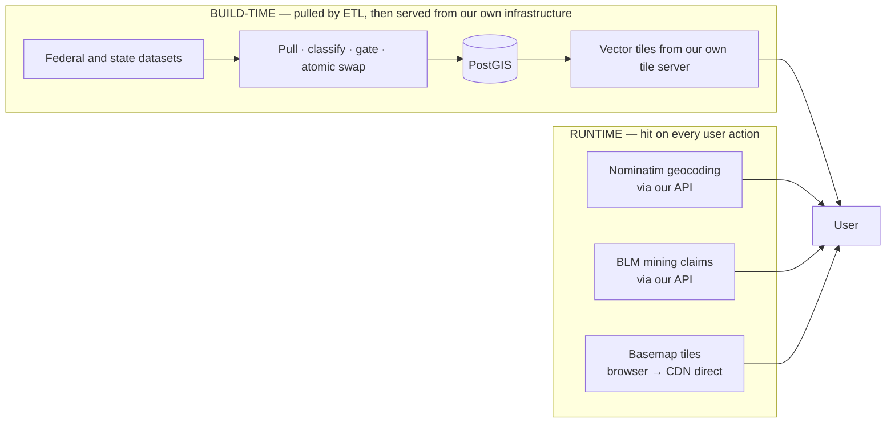

# OreScout — External Data Sources

**Audience:** internal stakeholders and new team members who need a complete picture of what data OreScout depends on, what each source does for the product, why it was chosen, what it costs us legally and operationally, and where the risks are.

**Status:** describes the sources **as wired on 2026-08-20**, read from the code and the source registry. Where documentation and code disagreed, the code is what is described here.

**Companion documents:** [`01-application-overview.md`](01-application-overview.md) · [`02-legality-engine.md`](02-legality-engine.md)

---

## 1. How to read this

OreScout depends on external data in **two fundamentally different ways**, and the distinction drives everything else in this document.

| | Build-time (ETL) | Runtime (live) |
|---|---|---|
| **When it runs** | On a refresh cadence | On every click or keystroke |
| **Cost per user** | **Zero marginal cost** | Scales with traffic |
| **What an upstream outage costs** | **Freshness only** — every job aborts and leaves the previous good data live | Immediate degradation, visible to the user |
| **Examples** | Land ownership, protected areas, claims overlay, waterways, geology | Geocoding, per-click claim check, basemaps |

**Almost everything is build-time.** That is a deliberate architectural choice, and it is why the projected hosting cost is ~$16–40/month rather than a per-request bill. The three runtime dependencies are the exceptions, and two of the three carry real commercial and legal considerations at scale (§6).

### The source registry

Every build-time source is described in **one JSON file** — `etl/sources.json` — carrying its endpoint, fields, licence, attribution string, vintage, refresh cadence, and the state-specific rules that govern how it is used. Exactly one small library reads that file; nothing else touches it directly.

Sources have one of four **roles**, and the role determines what the source is allowed to influence:

| Role | May influence the legal verdict? |
|---|---|
| `base` | **Yes — it produces the verdict.** Currently exactly one source |
| `confirm_open` | **Only to tighten it.** Can turn "open" into "cautious"; can never create "open" |
| `claims` | Feeds the claims overlay |
| `reference` | **No — structurally impossible.** Owns its own table, absent from the verdict pipeline |

**Known registry gap:** two real build-time dependencies — the **parcel adapters** and **Census state boundaries** — are not in the registry. They have no vintage, no freshness tracking, and no entry in the `/meta` endpoint, despite the parcels being safety-load-bearing. This is a known, filed gap (§7).

---

## 2. The master register

### 2.1 The legality base — the source everything rests on

| | |
|---|---|
| **Source** | **PAD-US 4.1** — Protected Areas Database of the United States |
| **Publisher** | US Geological Survey, via ScienceBase |
| **Provides** | Managing agency, owner type, protective designation, protection-status tier, unit name |
| **Powers** | **The entire RED / YELLOW / GREEN verdict engine** |
| **Acquisition** | Bulk per-state File Geodatabase downloads, ~1.5 GB for eight states |
| **Volume** | **86,913 features** across the eight states |
| **Licence** | Public domain (US Government work) |
| **Vintage** | PAD-US 4.1 (2024 data) |
| **Cadence** | 900 days — **human-approved release bumps only** |

**Why this source.** It is the only free, national, polygon-level dataset that carries both *who manages the land* and *what protective designation applies*, at high resolution.

**What was rejected in its favour.** The original plan was to use BLM's national Surface Management Agency layer as the primary "who manages this dirt" signal, because its agency codes are cleaner. Real data killed it: that layer returns **518 dissolved blocks for eight states**, against PAD-US's ~75,000 detailed features. Cross-checking against something that coarse would have bled coarse private and tribal blocks over fine open-BLM polygons and produced **false prohibitions**. Detailed *per-state* SMA layers were adopted later instead, in a different role (§2.2).

**How we get it changed.** Ingest originally used a live government query API. That API rate-limits bulk extraction and throttled the pull mid-run, so ingest moved to authoritative bulk downloads. This was initially recorded as a manual annual step; it was later re-tested, found to be fully scriptable, and automated. The **swap remains human-approved** — see §5.

**The single most important caveat in the entire product.** PAD-US is the *Protected Areas* Database. It is **not a cadastre.** It barely maps private land at all. Validation against 15 known private inholdings found **12 with no PAD-US polygon whatsoever**, 2 correctly cautious, and 1 shown as open (Alta, Utah — where PAD-US over-maps Forest Service land across a private townsite).

This single finding is why the entire product architecture pivoted to **"confirm open, don't enumerate private."** Private-land safety rests on the *no-data-means-cautious* fallback, not on PAD-US flagging private land as prohibited. See [`02-legality-engine.md`](02-legality-engine.md) §1.

**Release-bump risk.** Every new release requires reconciling the classifier against new attribute vocabulary. The 4.1 bump introduced **21 new designation codes**; fifteen already resolved correctly through their managing agency or ownership type, and the rest needed a human decision. A gate now fails loudly on any unmapped code, because an unmapped code silently becomes *open*.

### 2.2 The eight confirm-open sources — one per state

These sources **never create "open." They subtract it.** Each is the state's own authoritative land-ownership layer; PAD-US "open" land that is not near confirmed public land gets rewritten as cautious.

| State | Source | Publisher | Volume | Licence |
|---|---|---|---|---|
| **CA** | California Land Ownership (FRAP) | CAL FIRE | 57,404 polygons | **CC-BY** |
| **UT** | SGID / SITLA statewide Land Ownership | UGRC / Utah SITLA | 16,017 polygons | **CC BY 4.0** |
| **NV** | Nevada Surface Management Agency | BLM | 14,637 polygons | Public domain |
| **AZ** | Arizona SMA (ALRIS lineage) | BLM Arizona | 17,588 polygons | Public domain |
| **CO** | Colorado Surface Management Agency | BLM Colorado | 21,181 polygons | Public domain |
| **NM** | New Mexico Lands SMA | BLM New Mexico | 19,232 polygons | Public domain |
| **OR** | Ownership / Land Management framework | Oregon Dept. of Forestry | 3,218 polygons | Open state data |
| **ID** | Idaho Surface Management Agency | Idaho Dept. of Lands | 23,850 polygons | Open state data |

**Why one per state rather than one national layer.** Different states genuinely have different best-available data, and the national alternatives are too coarse to be safe (§2.1). Research in July 2026 verified that each of the **six** states then still uncovered had a detailed layer carrying *affirmative private* ownership, so the pattern first built for Utah generalised across them without any state needing a weaker public-only fallback. California remains the exception — see the caveats below.

**The judgement calls, per state, are in the registry.** Each entry defines what counts as *public* (which forms the 100 m protective buffer) and — required, the build refuses to run without it — what counts as *public but not open* (state trust, parks, wildlife, county, military), which produces a distinct and more informative warning. A third, optional expression can name affirmatively private land to carve back out of the buffer; only Utah sets it, and for the other states the not-public set is derived by complement. Two locked policies: **NULL or unknown ownership never counts as public**, and Idaho's "other" code — which is effectively tribal — is treated as not public.

**Quality caveats worth knowing:**

- **California maps public ownership only.** Private land is *absent*, not *labelled*, so California has to infer private by complement. A cross-check run in June 2026, before the California confirm-open layer was built, found the base data ~99.66% accurate for California open land with a residual **0.34%** — a genuinely ambiguous mix of real private inholdings and coverage gaps. Building the confirm-open layer took that measured over-claim to **0.00%** on the same cross-check; the structural weakness (no affirmative-private layer to sample) remains, and is why California is the weakest state for the output-property gate.
- **Nevada's snapshot is from April 2023** — around three years old — because the live equivalent is impractical to page at volume.
- **All SMA sources are survey-grade (PLSS/GCDB), not parcel-grade.** This is precisely why parcel-sized private inholdings leak. The measured leak rate in counties without parcel data is **~0.60% per parcel**.

### 2.3 Mining claims — used two different ways from one source

| | |
|---|---|
| **Source** | BLM National MLRS Mining Claims — **Not Closed** |
| **Publisher** | Bureau of Land Management (Mineral & Land Records System) |
| **Licence** | Public domain |
| **Freshness** | **The freshest data in the product** — last-modified was *yesterday* at verification |

**Two consumption paths:**

| | Bulk ingest | Live per-click check |
|---|---|---|
| **What** | ~497,400 claim polygons for eight states | "Is there a claim within 100 m of this point?" |
| **Feeds** | The orange claims overlay (zoom ≥ 9) | The verdict escalation |
| **Cadence** | Nightly (2-day maximum age) | Every assessment, 1-hour cache |
| **Timeout** | n/a | 10 seconds |

**Why both.** An earlier design proxied claims live per map viewport. That was replaced with a nightly bulk ingest for three reasons: full coverage at all zoom levels; no 2,000-row pagination cap at render time; and **no third-party dependency in the map render path.** The live query is retained *only* for the per-point verdict, where accuracy matters most.

**Why a 100 m buffer.** Claim polygons are PLSS survey aliquots (~20.66 acres) with real gaps between them. A raw point-intersect frequently returns nothing when a claim is plainly there.

**A product constraint worth knowing: the layer carries no claimant name** — it is redacted. So the app shows "a claim exists here, serial number X" and **deep-links to BLM's own case-detail report** for the ownership lookup. That link is the answer to "who do I contact?"

**Accepted inconsistency:** the *overlay* is up to a day stale while the *verdict* is live, so a user can see an orange claim polygon while the assessment reports none. Recorded and accepted, on the reasoning that the fresher of the two is the one that gates a go/no-go decision.

### 2.4 Reference layers — display only, structurally unable to change a verdict

#### Historic gold occurrences (MRDS)

| | |
|---|---|
| **Source** | USGS Mineral Resources Data System — Compact Version, plus a bulk relational export for enrichment |
| **Volume** | **55,512 gold sites, 28,540 of them recorded producers** |
| **Licence** | Public domain |
| **Vintage** | **Static — USGS stopped updating it in 2011** |

Filtered to gold occurrences only. **Roughly 15 years stale and will never improve**, which the app states explicitly on both the layer hint and the popup.

The compact service exposes no related tables, so commodity, mineral and alternate-name enrichment comes from a separate bulk relational export. The join key was a trap solved empirically — a per-table index column looks like a key but is a global row index.

**Alternative considered:** USMIN, a curated and current USGS mine/prospect dataset. **Rejected as a replacement** because it carries no commodity attribution; noted as a possible complement.

#### Prospecting potential (geochemistry + watersheds)

| | |
|---|---|
| **Sources** | USGS National Geochemical Database (2026 consolidated release, DOI `10.5066/P1FXE9GK`) + USGS Watershed Boundary Dataset |
| **Volume** | 1.52M samples nationally; we score ~320,000 eight-state stream sediments → **18,042 markers** |
| **Licence** | **CC0** (geochemistry) / public domain (watersheds) |

This layer answers *"where is it genuinely worth checking?"* — never *"is it legal?"*

**The finding that reshaped the feature: gold is effectively censored, not populated.** Standard analytical detection floors for gold sit orders of magnitude above natural stream-sediment background. Measured detected fractions nationally: **arsenic 42.5%, antimony 28.3%, silver 21.4%, gold 11.5%.**

So the score is **pathfinder-led** — arsenic, antimony and silver travel with gold in the same ore-forming fluids and are measurable at trace levels. Gold itself only counts when it was measured by one of four low-detection methods. That method allowlist was a near-miss: an early plan named only fire assay and neutron activation, which **would have discarded HBr-extraction atomic absorption — on its own the single largest source of real gold values in the dataset.**

Watersheds are the pooling unit for "relative to local background" — 5 ppm arsenic means something very different in a quiet basin than in a mineralised belt. The **national** watershed file was taken deliberately rather than a hand-picked list of western regions, because eastern Colorado and New Mexico drain into a region a western list would have silently missed.

**Structural caveat:** watershed codes **are not stable across releases** — watersheds get re-delineated and re-coded. The download date is therefore stamped in the database, codes are never used as cross-version keys, and the two sources must always move together because watershed codes are pinned into the test fixtures.

**Face-validity check on the output:** the highest-scoring watersheds include the Gold Hill district in Utah, Grass Valley in the Mother Lode, and Battle Mountain in Nevada. The Mother Lode bounding box produces 31 high-tier markers, the Carlin trend 17, Oregon just 20 statewide, and a Central Valley farmland control produces **zero**.

#### Waterways

| | |
|---|---|
| **Source** | USGS NHDPlus High Resolution — stream and river centerlines |
| **Provides** | Perennial vs. intermittent classification, plus flow direction for the chevron arrows |
| **Licence** | Public domain |

**This source replaced another one.** Version 1 shipped with a California-only stream layer. It was retired because it carried **no flow-permanence attribute** (so no perennial-vs-intermittent) and **no flow-direction field** — and it was one state. NHDPlus HR is the only current all-eight-state product carrying **both** together.

**And it is a source USGS has stopped producing.** USGS retired the underlying hydrography programme in October 2023. The official successor, 3DHP, was evaluated and **ruled out**: it is being built watershed-by-watershed over several years (California's fiscal-2026 allocation is 5 units), and — decisively — **its flowline layer has no permanence field at all**, so it literally cannot answer perennial-vs-intermittent. Re-evaluate in 12–24 months, gated on two concrete checks.

**Why a discontinued source is acceptable here:** waterways are display-only, so the strategy is **snapshot and pin**. A pinned copy has no runtime dependency. The archived release is the durable fallback. The residual risk is that USGS's commitment is only that static versions stay downloadable *"for several years"* — with no firm end date.

#### Access and trails

| | |
|---|---|
| **Sources** | USFS Motor Vehicle Use Map Roads · USFS MVUM Trails · USFS National Forest System Trails · BLM National Ground Transportation Linear Features (Public Display) |
| **Volume** | **302,270 classified segments** — 32,148 drive · 235,901 off-road · 34,221 hike-in |
| **Licence** | Public domain. USFS use-constraint verified: no access constraint, disclaimer only |

Four federal layers, one registry entry, one overlay. Federal-only by explicit decision — the federal rows alone give full eight-state coverage.

**An honesty finding worth quoting.** 97.6% of the staged Forest Service roads are *legally* open to passenger vehicles — but 96,000 of 114,000 are maintenance-level-2, high-clearance, native-surface roads. Classifying on the legal flag alone smeared everything into "drive," which would have told users a sedan could get somewhere it cannot. The shipped rule requires the legal flag **and** a maintenance level of 3–5.

**Two endpoint surprises that supersede the earlier research:** the National Forest System Trails download on the official clearinghouse is **reproducibly corrupt upstream**, so the loader integrity-checks the archive and falls through to a REST alternative; and the BLM transportation service the research pointed at now exposes only ~10,000 features nationally rather than the full ~170,000 network, so a different published service is harvested instead.

**Seasonal windows ship as advisory free text — never parsed, never styled.** And the click card carries a hard-coded disclaimer that the legally authoritative document is the per-forest Motor Vehicle Use Map, which is refreshed unit by unit and can lag a new travel decision.

### 2.5 Parcels — safety-load-bearing, and not in the registry

| State | Source | Volume | Notes |
|---|---|---|---|
| **UT** | UGRC statewide parcels, 14 rural/mining counties | 337,778 private parcels | **Best in class** — an explicit assessor "private" flag |
| **CO** | Colorado public parcels composite, 15 mining/foothill counties | 550,610 private / 7,754 public / 72,385 unknown | Owner-name classification |
| **NM** | NM Office of the State Engineer county parcels, 11 counties | 556,132 private / 3,408 public / 41,066 unknown | Owner-name classification |

**Two jobs:** they are the **frame for the statistical private-land validation**, and they provide the **parcel-grade protective carve** that survey-grade ownership layers cannot.

County-scoped by design — metro counties add volume, not validation signal.

**A privacy commitment worth stating explicitly to any stakeholder:** owner names are used *transiently* inside the transform to classify a parcel, and are **never loaded into the database and never committed to the repository.** The raw tables are dropped in the same operation.

**They earned their place immediately.** The first validation run using them found **9 real false-"open" results** out of 1,504 parcels — parcel-sized private inholdings inside blocks the survey-grade sources map as federal. All nine were individually verified as genuine private owners. That produced the parcel-grade carve; the final run was **0 of 1,504**.

**Known issue:** two owner-classification bugs are fixed in code but **blocked from being applied to the data**, because the protective carve only consumes parcels classified *private*. Applying the fix would move city, county and **tribal** parcels from private into public, which the carve ignores — stripping their protection. See [`02-legality-engine.md`](02-legality-engine.md) §7.

### 2.6 State boundaries

| | |
|---|---|
| **Source** | US Census Bureau TIGERweb state boundaries |
| **Powers** | The out-of-region gate, and the grey out-of-scope mask on the map |
| **Licence** | Public domain |
| **Cadence** | Static — never refreshed |

Also not in the registry.

---

## 3. Runtime dependencies

These are the three things that scale with traffic. Two carry commercial and legal considerations.

### 3.1 Geocoding — Nominatim (OpenStreetMap) — ⚠ **a stated launch blocker**

| | |
|---|---|
| **What** | Place-name search in the search bar |
| **How** | Proxied through our own API — never called from the browser |
| **Timeout** | 10 seconds |
| **Rate limiting** | A process-wide gate spacing upstream calls at least 1 second apart, plus a 24-hour cache |
| **Failure** | HTTP 503 `geocode_unavailable` — retryable, not a generic error |

**Three design details worth knowing:**

- **Results are biased to the west, then filtered exactly.** Nominatim ranks its top results by *global* importance, so without a western bias a common name like "Bear Creek" returns only Appalachian hits and nothing western survives our state filter. The bias shapes the candidate pool; the exact per-state filter is authoritative.
- **Empty results are cached too** — "no matches" is an answer, and caching it protects the upstream service.
- **Failures are never cached**, so recovery is immediate.
- **The geocoder is proxied specifically so the provider can be swapped without touching any client.**

**⚠ The commercial problem, stated plainly.** The public OpenStreetMap Nominatim instance's usage policy prohibits **exactly what a public OreScout would do to it**: an absolute 1 request per second, **no autocomplete**, moderate user bases only, and access withdrawable *without notice*. The app's type-ahead dropdown *is* the autocomplete pattern the policy forbids. The 1-second gate and 24-hour cache keep the proof-of-concept compliant on load, but they do not make the usage pattern policy-compliant at scale.

**This is recorded as a launch blocker, not a polish item.** Alternatives are already priced:

| Option | Free tier | Paid |
|---|---|---|
| **LocationIQ** | 5,000 req/day with attribution | $100/mo → 25,000/day |
| **Geoapify** | 3,000 credits/day, commercial use OK | $59/mo → 10,000/day |
| **OpenCage** | Testing only | $50/mo → 10,000/day |
| **Self-hosted Photon** | — | A ~8–16 GB VM; cheapest at scale, most operational work |

Because the geocoder is proxied, **switching is a configuration change.**

### 3.2 The live mining-claims check

Covered in §2.3. Runtime characteristics: 10-second timeout, successes cached for an hour on a ~110 m grid, failures never cached, and an explicit check for the upstream service's habit of returning errors as HTTP 200 with an error body.

**On failure the user still gets a land verdict**, with an honest gap. Since the claims check can only ever *escalate* a verdict, its absence cannot create a false "open" — but it **can hide a real claim**, which is why a sentinel canary exists (see [`02-legality-engine.md`](02-legality-engine.md) §6.7).

### 3.3 Basemaps and map assets — everything the browser fetches directly

| Asset | Host | Notes |
|---|---|---|
| **Satellite (the default)** | Mapbox Satellite | Requires a token. Free tier 50k loads/month |
| **Street basemap** | CARTO Voyager | **Attribution mandatory:** © OpenStreetMap © CARTO. Note only one subdomain is used, with no round-robin — this caps browser parallelism |
| **Satellite fallback** | Esri World Imagery | ⚠ Keyless. See §6 |
| **Topographic** | USGS National Map | Public domain |
| **Map fonts** | MapLibre demo host | ⚠ Explicitly a **demo** service with no service-level agreement |
| **Icons** | — | **None fetched.** Every icon is drawn at runtime on a canvas |

**Two design notes worth knowing:**

- **There are no sprite files.** The cross-hatch pattern, the flow chevrons and the three prospecting glyphs are all drawn programmatically in the browser. This eliminates an entire class of external dependency. And because a map symbol layer renders *nothing at all* when its image is missing, both symbol families ship with fail-safe plain-shape under-layers — a missing icon degrades to visible dots, never to invisible land.
- **The tile URL is a single configuration point.** Every overlay tile request routes through one setting, deliberately preserved so an authenticated tile proxy can be introduced later without touching any layer code.

---

## 4. Licensing summary

### Public domain — no constraints, attribution courteous

PAD-US · BLM mining claims · all four BLM state ownership layers · USGS gold occurrences · USGS waterways · USGS watersheds · USGS topographic basemap · Census state boundaries · USFS roads and trails · BLM transportation.

The USFS use constraint was **verified in July 2026**: no access constraint, only a no-warranty and a "these are not legal documents" disclaimer.

### CC0 — no rights reserved

USGS geochemistry (2026 release).

### CC-BY — **attribution is a legal obligation, not a courtesy**

- **CAL FIRE / FRAP** → *"CA Land Ownership © CAL FIRE/FRAP"*
- **UGRC / SITLA** → *"Land ownership © UGRC/SITLA"*

### Open state data, as-is

Oregon Dept. of Forestry · Idaho Dept. of Lands · NM Office of the State Engineer parcels.

### ⚠ The four a business stakeholder must know about

1. **Colorado parcels forbid resale.** Validation and internal carve use is within terms — the parcels never reach a map tile. **Any future product that surfaces Colorado parcel geometry to users needs a fresh licence read.**

2. **OpenStreetMap-derived data is ODbL.** This bites in two places. The CARTO basemap: rendered tiles are a "Produced Work," so only the attribution is owed — and it is rendered. **Future OSM trail geometry: share-alike could encumber the routing database.** Counsel review is recorded as a hard gate before any such merge.

3. **The Nominatim public instance is not licensed for this use pattern at scale.** See §3.1. Launch blocker.

4. **Esri World Imagery.** The project's own assessment: *"Esri World Imagery's free tier does not cleanly license direct tile access outside Esri's own SDKs, which becomes a real problem the moment OreScout is public."* It is currently wired as the **automatic fallback whenever the Mapbox token is absent** — which means **a misconfigured production deploy would silently serve tiles under a licence the project has already judged inadequate for public use.** Mapbox is the intended default; switching is a one-line change. **This should be a deployment checklist item.**

### The one that would have been a problem at scale

**Regrid / Loveland** — commercial nationwide parcel data, recorded as a **~$12,000/year baseline to beat** (actual pricing is quote-only). **Rejected**, and the reasoning is instructive: the licence permits displaying tiles but **forbids caching or ingesting** the data without written approval. That forces a metered live per-click dependency whose **cost scales with popularity** — precisely the wrong curve for a free public tool, and it forecloses the flat-cost ingest model every other source in the stack enjoys. Kept on the table as a future option for rural Nevada specifically, which is the largest uncovered gap.

---

## 5. Refresh and currency

### How staleness is tracked

Every source has a row in a registry table recording its role, vintage, last refresh, maximum age, last gate status, and an upstream watermark. It is written **only after a successful atomic swap**, so a failed job never marks itself fresh.

This surfaces in three places:

1. **The API** — the `/meta` endpoint returns per-source freshness, with staleness **computed server-side** so every client shows the same answer.
2. **The app** — a per-source freshness badge with a "may be outdated" suffix. Unknown source keys fall back to the raw key, so a newly added source renders correctly with zero UI changes.
3. **Operations** — a freshness check that exits non-zero if any source is stale or its last gate failed. Intended as the production alerting probe.

### The three cadence classes

| Class | Sources | Policy |
|---|---|---|
| **1 — nightly, fully automatic** | Mining claims (2-day max age) | High churn, low schema risk. Wholesale replace, mechanically gated |
| **2 — periodic, fully automatic** | Utah ownership (quarterly), CAL FIRE (semi-annual) | Same-shape re-pulls, schema assertion plus gates before swap |
| **3 — versioned, human-approved** | PAD-US (900 d), geochemistry and watersheds (540 d) | These change schemas, code vocabularies and semantics between releases |

The class-3 reasoning is recorded bluntly: ***"Blindly auto-swapping the legality base or the fixture-pinned prospectivity substrate is how you get a confidently-wrong map."*** Automation **detects, prepares and verifies**; a human approves the swap. This is a policy gate, not a technical limitation.

### Upstream change detection

A read-only watcher checks for new releases **without downloading anything** — publication dates on archive items, last-modified headers, service edit timestamps — and compares them against the stored watermark.

**⚠ It watches only 5 of the 15 registered sources** — the land base, geochemistry, watersheds, and the Utah and California ownership layers.

The **six BLM and state ownership layers for Nevada, Arizona, Colorado, New Mexico, Oregon and Idaho** — which carry maximum ages of 365–540 days and **directly gate whether land shows as open** — have **no upstream watcher and no automated refresh job at all.** When they come due, the refresh check reports them as due with no way to satisfy them. The only two ownership layers that *are* watched (Utah, California) are also the only two with a job mapped.

### What is automated versus manual, today

✅ **Automated preparation for everything**, including the ~1.5 GB base-data download that used to be a manual step.
✅ **A due-check** that reads the registry and runs the class-1 and class-2 jobs that are past cadence, printing a runbook pointer for class-3 rather than running it.

❌ **No scheduler exists.** The nightly claims refresh is hardened and ready but **runs by hand**. This is deliberate on a development machine — *"a sleeping laptop with no alerting is worse than a human running the job"* — and real scheduling is **blocked on having a network-reachable hosted database**, which means deployment. The plan is Azure Container Apps scheduled jobs, with GitHub Actions as an acceptable interim.

❌ **The access-and-trails overlay has no refresh job wired at all.** It has a 180-day maximum age and will report as due with no way to satisfy it.

---

## 6. Risks

### Single points of failure

| Risk | Mitigation |
|---|---|
| **PAD-US is the whole verdict engine** — one source, one cadence, one classifier. A bad release bump that is not reconciled produces a *confidently wrong* map | The unmapped-code gate fails loudly; rule and coordinate fixtures gate every build; the swap stays human-approved |
| **Nominatim is the only geocoder**, and access is withdrawable without notice | Alternatives priced; the swap is a config change. **But it is not done** |
| **The map font host is a demo service with no SLA.** If it fails, every text label on the map disappears | Icons are unaffected — they are drawn locally |
| **The street basemap uses a single CDN subdomain** with no round-robin | Load concentrates on one host |

### Upstreams with no service-level agreement

The repository states it directly: **the two main federal hosts have no SLA, and both flaked during our own work.** One intermittently serves HTML error pages with an HTTP 200 status — which is why the base-data loader sanity-checks file size and archive magic bytes before trusting a download.

### Endpoint fragility that had to be engineered around

- **Every ArcGIS source caps at 2,000 records per query — a naive request silently truncates.** Every loader paginates.
- **ArcGIS reports query errors as HTTP-200 JSON bodies.** An unhandled error body reads as "zero features." This is handled explicitly in the claims, ownership, access and parcel loaders and in the live claims service. By inspection, the **California and Utah ownership loaders carry no such check** and would treat an unparseable body as "zero results, stop paging."
- **Federal ArcGIS servers return sporadic 5xx errors under deep pagination.** The access loader carries a five-attempt retry with linearly increasing backoff, on top of the HTTP client's own retry.

### Large and heavy downloads

| Source | Size |
|---|---|
| Waterways (development ingest) | ~18 GB across 62 units, streamed |
| Waterways (production target) | 31.3 GB single file, ~150 GB scratch space |
| Watersheds | ~2.6 GB |
| Land base | ~1.5 GB |
| Geochemistry | ~300 MB |
| Forest Service roads and trails | ~113 / 35 / 118 MB, **with filenames that change every refresh** — resolved by scraping the publisher's landing page at ETL time. If that page is restructured, the loader aborts |

### Known-stale sources

| Source | Status |
|---|---|
| **Gold occurrences (MRDS)** | **Frozen since 2011.** ~15 years stale, will never improve. Labelled as historic in the UI |
| **Nevada ownership** | April 2023 snapshot, ~3 years old |
| **Waterways** | **Production halted by USGS.** The pinned-snapshot strategy makes it survivable, but the commitment is only "downloadable for several years," with no firm end date |
| **Waterways (development ingest)** | Mixed vintage 2022–2024 across units, not one coherent release |

### Failure modes already engineered around

| Failure | Guard |
|---|---|
| The claims service silently renamed → returns "no claims" forever → enables false "open" | Sentinel canary at a known claim-dense location |
| Tile server timeout at low zoom → HTTP 500 → **prohibited land renders blank** | Generalised low-zoom tables, plus a fail-loud tile error banner |
| A missing icon silently hides the cautionary hatch or prospecting markers | Fail-safe plain-shape under-layers |
| An unknown verdict value renders as innocuous blank ground | A bright magenta catch-all layer |

### The residual, stated honestly

The measured per-parcel false-"open" leak in counties **without** parcel data is **~0.60%**. **Rural Nevada is the largest uncovered area** — the project's own note calls it *"the honest gap"* and *"the spot where commercial parcel data earns its keep pre-launch."*

---

## 7. Sources evaluated and not used

This table is deliberately preserved — knowing what was rejected and why is as valuable as knowing what was chosen.

| Source | Considered for | Outcome | Reason |
|---|---|---|---|
| **BLM National SMA (LimitedScale)** | Primary land-manager signal | **Rejected** | 518 dissolved blocks for eight states vs. ~75,000 detailed features. Cross-checking would have produced **false prohibitions** |
| **PAD-US live REST API** | Base-layer ingest | **Retired** | The query API rate-limits bulk extraction |
| **CDFW California Streams** | Waterways v1 | **Built, then replaced** | California-only, no flow-permanence, no flow direction |
| **3DHP** (the official NHD successor) | Waterways | **Ruled out; revisit in 12–24 months** | Years from complete, and **no permanence field at all** — it cannot answer perennial vs. intermittent |
| **USMIN** | Replace/complement gold occurrences | **Not used** | Curated and current, but **no commodity attribution** |
| **Regional watershed files** | Watersheds | **Rejected for the national file** | A hand-picked western list would silently miss eastern-draining units |
| **A live geochemistry host** | Geochemistry | **Rejected** | Returned server errors during evaluation. Download and host instead |
| **Regrid / Loveland** | Nationwide private cadastre | **Rejected; kept as a future rural-Nevada option** | ~$12k/yr baseline (quote-only), and the licence **forbids ingest** — forcing a metered per-click cost that scales with traffic |
| **California parcels** | California ground truth | **Deliberately excluded** | Would be **circular** with California's confirm-open logic |
| **Idaho parcels (IDWR)** | Idaho ground truth | **Excluded** | Hostile licence text; county fallbacks exist |
| **Oregon statewide taxlots** | Oregon ground truth | **Excluded** | No open statewide service exists — verified dead ends |
| **Rural Nevada parcels** | Nevada ground truth | **Unsolved gap** | Only two metro counties available |
| **OpenStreetMap trails** | Access gap-filling | **Deferred — legal** | ODbL share-alike could encumber a derived routing database. **Counsel review required before merging** |
| **Recreation.gov, NPS trails, USGS trails, five state trail layers** | Trail density | **Deferred** | The federal backbone already covers all eight states |
| **Nevada OHV trails** | Nevada trails | **Rejected** | PDF/KML only — no open GIS service, licence unclear |
| **BLM transportation bulk download** | Preferred harvest path | **Does not exist** | Searched and confirmed absent. Paged REST is the only path |
| **Sentinel-2 / NAIP imagery** | Alternative basemaps | **Listed, never implemented** | |
| **A routing engine** | "Best way to get there" | **Explicitly deferred** | Highest-risk piece; depends on the access data already built |

---

## 8. Cautions when reading the older engineering documents

| Older claim | Reality |
|---|---|
| *"Upgrade to PAD-US 4.2 pending"* | **There is no PAD-US 4.2.** 4.1 is current; "4.2" was an anticipatory label. **Do not put it in stakeholder material** |
| The v3.0-era polygon and claim counts in the README | Long superseded — see §2 |
| The CAL FIRE endpoint given in the research doc | That host is **not reachable**; the code uses a different hosted service |
| The BLM transportation service named in the research doc | Now exposes only ~10,000 features nationally. **Read the bottom of that document, not the top** — its own "what was actually ingested" section supersedes its earlier tables |
| A "live registry" table listing a retired California streams source | **Retired.** It still appears in one legacy setup script and would show as a phantom entry in a database built that way. Treat the source registry file as authoritative |
| Trail overlay zoom level | The code and the plan both say zoom 9; one backlog note says 8. **Code wins: 9** — zoom 8 was rejected on measured tile weight |

**Two registry gaps to keep in view:**

1. **Parcels are not registered.** They are a safety-load-bearing verdict input with real licence terms, yet they have no vintage, no maximum age, no freshness gate, and no entry in the `/meta` endpoint — while every other verdict-affecting source does. The registry claims to be the single source of truth; for parcels, it is not.
2. **Census state boundaries are not registered** either, despite driving the region gate and the map's out-of-scope mask.

**One point of clarification that has confused readers:** the California registry entry declares its private-carve field twice, and the second (null) declaration wins. This is **cosmetically confusing but functionally harmless** — California uses a hand-written build file that implements the tribal and non-profit carve directly, and that file's comments correctly note the registry value is null. Worth tidying so nobody reads the first line and assumes the carve is registry-driven.

**Finally:** the substantial body of state, county and municipal collecting-law research in the repository is **not read by any code path**. It is a knowledge asset that justifies the rules the classifier encodes — see [`02-legality-engine.md`](02-legality-engine.md) §8. Its own notes flag that several municipal-code publishers block automated fetching, so some citations were reconstructed from search results and **need human verification before being presented as law.**
